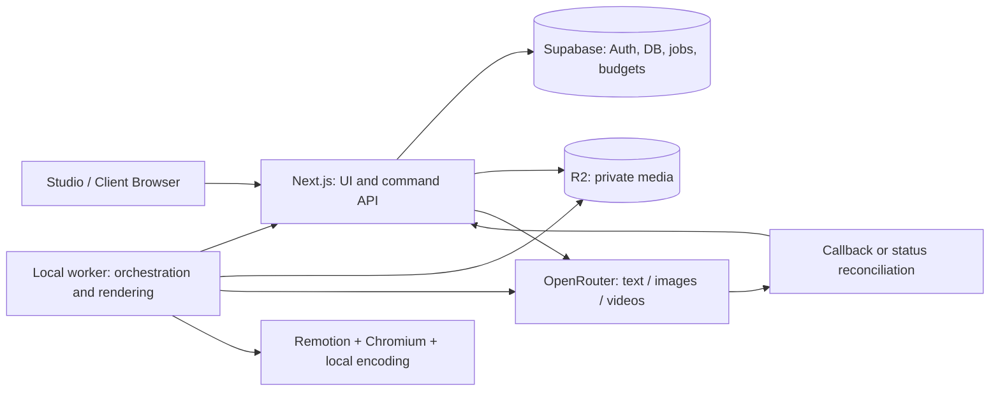

# AI Marketing Studio: From-Scratch Implementation Plan for Claude Code and Codex

**Version:** 1.0 · **Date:** October 24, 2026.

**Primary specification:** [production workflow, version 2.0](product-spec.md). This document turns it into application architecture, setup order, contracts, and verifiable coding-agent tasks. The application has not been implemented as part of this document; the commands are intended for development.

**Repository-specific handoff note:** this handoff targets a repository with an existing Next.js starter. Inspect and extend it; do not recreate the application. Scaffolding commands below apply only when no Next.js application exists. Place these files at `<repo>/docs/product-spec.md` and `<repo>/docs/implementation-plan.md`; `/docs` here means the repository directory, not an operating-system root directory.

**Owner update, October 24, 2026:** all application interface must be English. The supplied Toggle landing references guide the studio visual design. This supersedes the earlier Russian UI default; Russian creative examples remain valid for `ru-RU`. Current implementation status is tracked in [progress](progress.md); the roadmap below is not a claim that later milestones are complete.

## How to use this plan

1. Give the coding agent both Markdown documents in the target repository.
2. Use the starter prompt in section 19.
3. Execute milestones with verifiable outcomes. Either Claude Code or Codex can implement; the other can review, and roles can alternate.
4. Supply keys through local/secure settings, never prompts, documentation, or git.
5. Start in mock mode without paid calls, then connect integrations and run budget-limited live smoke tests.

Requirement priority: latest owner instructions → production spec v2.0 → this plan → internal technical choices. Application API names below are proposed contracts, not Supabase/OpenRouter methods provided out of the box.

## Contents

1. [Non-negotiable requirements](#requirements)
2. [Architecture and compute boundaries](#architecture)
3. [Repository bootstrap](#bootstrap)
4. [Keys, environment, and setup wizard](#configuration)
5. [Models and providers](#providers)
6. [Data and roles](#data)
7. [Runs, rounds, checkpoints, and replay](#workflow)
8. [Drafts, variants, and proxy-to-final](#creative)
9. [Dashboard and UX/UI](#dashboard)
10. [Agent correction prompts](#interventions)
11. [Pricing, caps, and financial ledger](#budget)
12. [API and events](#api)
13. [Local runner and media pipeline](#runner)
14. [Development milestones](#milestones)
15. [Verification and acceptance demonstration](#verification)
16. [Security](#security)
17. [Claude Code and Codex workflow](#coding-workflow)
18. [Owner inputs](#owner-input)
19. [Ready-to-use prompts](#prompts)
20. [Sources and technical decisions](#sources)

<a id="requirements"></a>
## 1. Non-negotiable requirements

### 1.1. The client participates three times

- **C1:** questionnaire, every variation axis, and scope.
- **C2:** exactly three complete web drafts; select the ordered number of directions, request changes, or accept.
- **C3:** final results after AD review; request changes or accept.

Repeated C2/C3 rounds remain within the same logical stage. Do not add mandatory client strategy/script/kit/asset approvals between them.

### 1.2. Three mandatory AD checkpoints

- **A1:** supply every brand input/instruction and review the complete Brand Kit.
- **A2:** review scripts/layout before the three drafts reach the client.
- **A3:** review final output before client delivery.

The AD may intervene at any time, but the standard pipeline must not accumulate more mandatory approvals. Technical validators and budget checks are not extra meetings.

### 1.3. Drafts already look like creatives

Copy, composition, typography, web motion, and lightweight images are complete. Video/3D are replaced by suitable generated low-resolution images, without expensive generation. Draft/final use the same compositor. The client sees one reference ratio; all ordered-format bindings/plans already exist and validate by A2.

### 1.4. Variations are defined at C1

Languages, hook/beat slot counts and identities, durations, number of final concepts, CTA/offers, formats, and quantities come from the brief. Owner update (October 25, 2026): actual hook copy and narrative beat content are generated with the scenarios after A1; C1 accepts optional creative guidance and does not require clients to write these definitions. Never generate the full Cartesian product automatically. Count draft directions—always three—separately from selected final directions.

### 1.5. Agent and spending control

Models are configurable per role/task type. Each agent's activity, output, and errors are visible. Correction prompts create explicit attempts with context and audit. Show per-step cost, step/run caps, and all retry/client-round spending. Replay never resets budgets.

### 1.6. Stack and infrastructure

Next.js + TypeScript + shadcn/ui; Supabase data/Auth; S3-compatible R2 media. OpenRouter initially handles agents/images/video; a separate adapter later adds 3D/3D-to-image. Rendering, encoding, thumbnails/proxies, and media analysis are local. “No server rendering” applies to creatives; Next.js Server Components for application UI are allowed.

<a id="architecture"></a>
## 2. Architecture and compute boundaries

### 2.1. Three executable parts

**`apps/studio-web`: Next.js App Router.** Studio dashboard, client portal, wizard, preview. Route Handlers provide authentication/authorization, commands, signed URLs, callbacks, and short provider dispatch/status operations. Verified Postgres RPCs implement transactions, not disconnected browser requests.

**`apps/local-runner`: Node.js process.** Durable orchestration, agent execution, import/hash/inspection, scene assembly, proxies, local Remotion/Chromium rendering, encoding, upload. It runs independently of the Next.js tab, never inside a serverless Route Handler.

**Supabase + R2.** Persist states, revisions, jobs, budgets, previews, originals, manifests, exports. No video rendering here. Separate media and database backups immediately.



Direct worker access to OpenRouter denotes an authorized mode through a shared provider gateway, not credentials in the creative sandbox. In the initial local deployment, Next.js and worker share a server-only adapter on one device. With hosted portal, worker gets scoped dispatch permission through API; there must not also be a shared-key bypass around caps.

### 2.2. Two deployment modes

**Initial setup:** local Next.js/runner, remote Supabase/R2. Test the whole process on one machine. Simulate client review with a separate account. Real remote clients need a hosted portal or controlled access; the operator's localhost is not inherently reachable.

**Real operation:** host Next.js UI/thin API, keep data in Supabase/R2 and rendering/orchestration on local studio computers. Hosting UI must not implicitly enable server video rendering.

Direct LLM/image HTTP operations have finite timeouts. If an endpoint exceeds hosting limits, use an appropriate long-lived gateway or trusted local dispatch, not a heavy serverless worker. Video generation is asynchronous with job IDs/status [R3].

### 2.3. Shared packages

```text
apps/
  studio-web/
  local-runner/
packages/
  contracts/          # Zod/JSON Schema, migrations, transport types
  domain/             # Campaigns, decisions, rounds, invalidation
  workflow/           # Dependency graph, dispatch, retry, replay
  providers/          # OpenRouter and future 3D adapter
  budget/             # Estimate, reserve, settle, reconcile
  scene-compiler/     # SceneSpec → resolved composition
  layout/             # Slots, constraints, all placements/locales
  components/         # Validated creative React/SVG/Three components
  rendering/          # Browser/local backend adapters
  media/              # Local inspect/hash/proxy/bake
  delivery/           # Manifests and packages
  test-fixtures/      # Mock providers/demo campaign
supabase/
  migrations/
  tests/
docs/
  product-spec.md
  implementation-plan.md
  progress.md
  decisions.md
```

Split server/local exports from browser-safe types in `providers`/`media`. Public imports must not pull Node modules or secrets into clients. A separate `ui` package is unnecessary until there is another UI application; shadcn components can live in `apps/studio-web/src/components/ui`.

<a id="bootstrap"></a>
## 3. Repository bootstrap

### 3.1. Before creation

Read repository instructions/files and preserve existing work. Select a supported Node LTS compatible with checked Next.js/Remotion and pin it in `.node-version` or equivalent. Pin one pnpm version in root `packageManager`. Do not leave `latest` as a permanent production dependency.

Then create a pnpm workspace where appropriate:

```yaml
packages:
  - apps/*
  - packages/*
```

For this handoff, Next.js is already present. Preserve it; create only missing structure. The proposed `apps/` layout is a target, not permission to move every starter file before establishing a working baseline.

### 3.2. Next.js and shadcn/ui creation

For a truly new workspace without an existing application, these commands apply during implementation, not as already-executed work:

```sh
pnpm create next-app@latest apps/studio-web --ts --tailwind --eslint --app --src-dir --import-alias '@/*' --use-pnpm
```

Inside `apps/studio-web`:

```sh
pnpm dlx shadcn@latest init
pnpm dlx shadcn@latest add button input textarea select combobox dialog sheet tabs badge progress tooltip dropdown-menu separator skeleton alert sonner sidebar table command form
```

Verify current CLI flags/component names in official docs; use changed APIs when necessary and record decisions [R6], [R7]. Do not substitute a similarly named third-party registry for `ui.shadcn.com`. Do not add a heavy graph editor to the main screen merely to look agentic.

Install compatible versions of `@supabase/supabase-js`, `@supabase/ssr`, `zod`, AWS S3 client/presigner, Remotion Player/renderer/bundler, and required media packages. The spike determines exact packages; pin compatible Remotion versions together. `@remotion/web-renderer` is part of capability exploration, not mandatory for the first production renderer.

### 3.3. Root scripts

Implement documented commands rather than referring to nonexistent scripts:

```text
pnpm dev             # Next.js studio
pnpm worker:dev      # Separate local worker
pnpm typecheck
pnpm lint
pnpm test            # Unit/domain tests
pnpm test:db         # Local Supabase RLS/transaction tests
pnpm test:e2e        # Key browser flows
pnpm build
pnpm doctor          # Env/capabilities without printing secrets
pnpm seed:demo       # Controlled mock campaign
```

Mock mode requires no paid keys. Label mock fixtures/results; they cannot be presented as genuine generation.

### 3.4. Bootstrap definition of done

UI opens, shell is responsive, worker starts independently, both applications import contracts, and build passes. No paid requests, deployment, or migrations against an unintended production database before environment setup. `docs/progress.md` records actual checks and the next milestone.

<a id="configuration"></a>
## 4. Keys, environment, and setup wizard

### 4.1. Environment variables

`.env.example` contains empty credentials only:

```dotenv
NEXT_PUBLIC_APP_URL=http://localhost:3000
NEXT_PUBLIC_SUPABASE_URL=
NEXT_PUBLIC_SUPABASE_PUBLISHABLE_KEY=
SUPABASE_SERVICE_ROLE_KEY=
OPENROUTER_API_KEY=
S3_ENDPOINT=
S3_REGION=auto
S3_BUCKET=
S3_ACCESS_KEY_ID=
S3_SECRET_ACCESS_KEY=
THREED_PROVIDER_ID=
THREED_PROVIDER_API_KEY=
MOCK_PROVIDERS=true
```

Service-role, OpenRouter, and S3 secrets stay server/local-only. `NEXT_PUBLIC_` enters browser bundles and must never prefix secrets [R8]. Service role is limited to admin/control work, not ordinary user reads or creative sandboxes.

Worker separately configures API URL, device ID/scoped credential, cache/output paths, concurrency, and backend. A shared local deployment may use env in server-only adapters, but never pass credentials into render components.

### 4.2. More than just a key

Supabase needs URL, public key, privileged server credential, intended environment, and migration authorization. S3/R2 needs endpoint, bucket, region, access/secret keys, and CORS origins. OpenRouter needs a key and selected models/caps. An unspecified “S3 key” does not identify endpoint/bucket.

### 4.3. Setup wizard

1. **Data:** Supabase connectivity, migration state, Auth redirects.
2. **Media:** bucket, explicit tiny upload/download test, CORS, test-object cleanup.
3. **AI:** OpenRouter catalog, remaining key limit, per-role models.
4. **Device:** worker online, Chromium/renderer/codecs, disk/cache, sample render.
5. **Readiness:** connected, blocked, and mock-only capabilities.

Catalog checks must not secretly generate paid assets. A generation-test button shows model, minimal request, and cap. Never display the full key; show configured status and a safe fingerprint.

### 4.4. Entering secrets

Initially use `.env.local`/OS keychain and owner-only settings. Dashboard configures models, not readable keys. UI secret input later requires write-only endpoints, encrypted storage with a master key outside DB, masking, rotation, separate rights. Never store plaintext keys in settings JSONB or localStorage.

### 4.5. Future 3D/3D-to-image API

Until a concrete API is supplied, expose `capability = unavailable` with a reason. Implement a mock adapter/contract: inputs (prompt/image/mesh/camera), outputs (still/mesh/video), pricing, polling, cancellation. Preserve “3D-to-image”; do not reverse the direction by guesswork. Missing capability blocks that route, not campaigns that do not need it.

<a id="providers"></a>
## 5. Models and providers

### 5.1. Three separate OpenRouter adapters

**Text/agent:** chat completion with tasks, allowlisted tools, validated JSON output. Structured outputs only on supporting model/provider endpoints; validate even strict-mode results locally [R4].

**Image:** checked docs describe a dedicated images API and discovery. Image input is not image output. Use the documented endpoint and normalize bytes, MIME, usage, provenance [R2]; do not blindly use a text-chat example.

**Video:** async `POST /api/v1/videos → job ID → GET /api/v1/videos/{jobId} → download`. Validate duration, ratio, resolution, references against capabilities; `/api/v1/videos/models` exposes supported parameters [R3]. Do not send video generation through chat and expect a binary MP4.

At bootstrap, check official docs, then pin contract fixtures/adapter version. Provider DTOs stay inside adapters; raw responses are not the only domain contract.

### 5.2. Model registry

Normalized descriptor:

```ts
type ModelDescriptor = {
  providerId: string;
  modelId: string;
  label: string;
  inputKinds: ('text' | 'image' | 'video' | 'audio' | 'mesh')[];
  outputKinds: ('text' | 'image' | 'video' | 'audio' | 'mesh')[];
  supportsTools: boolean;
  structuredOutput: 'native' | 'best_effort' | 'none';
  supportedAspectRatios?: string[];
  supportedDurations?: number[];
  pricingRevisionId: string;
  discoveredAt: string;
  status: 'available' | 'unavailable' | 'needs_verification';
};
```

General and modality catalogs may differ in `supported_parameters` shape. Normalize with adapters, not unsafe casts. The checked general models API supports output-modality filtering; definitive endpoint capabilities may differ [R1], [R2].

### 5.3. Model assignments

Hierarchy: workspace preset → campaign preset → role → task type → explicit rerun override. Freeze effective configuration per task/attempt.

Initial roles:

- intake normalizer;
- brand kit builder;
- researcher/evidence checker;
- strategist;
- variant planner;
- concept/script writer;
- localization/copy editor;
- visual direction planner;
- image producer;
- video producer;
- future 3D producer;
- creative coder;
- layout planner;
- critic/QA assistant.

Deterministic layout, transcoding, hashing, budget arbitration, and approvals are regular code with no model assignment. Explain this so “model for all agents” does not turn technical guarantees into optional LLM opinions.

### 5.4. Model selection UX

The “Agent Models” screen shows roles, selected models, capability badges, presets/overrides, price units, and tests. Search names/IDs and filter required output modalities. “Apply to LLM roles” does not assign text models to image/video producers.

“Economy,” “Balanced,” and “Maximum quality” may name user presets, not unverified rankings. Until real IDs are chosen, show “select a model,” not fictitious slugs.

Model changes do not alter in-flight requests. Offer “For future tasks” and “Rerun this step with this model”; each records configuration revision and updated estimate.

### 5.5. Provider request lifecycle

`validate capability → freeze request/config → estimate upper bound → reserve → dispatch → persist external ID → observe → collect → validate artifact → settle usage`.

Unknown submit outcomes retain holds. Inspect status before another paid request. Never assume undocumented cancellation/idempotency. Store raw usage/generation ID for reconciliation and expose normalized cost [R5].

<a id="data"></a>
## 6. Data and roles

### 6.1. Migrations and contracts first

Before UI automation, version BriefSubmission, BrandKit, VariantPlan, ScriptSpec, SceneSpec, DraftBatch, FinalResourceContract, ClientCheckpoint, ChangeRequest, ExecutionConfig, TaskEnvelope, AgentResult, CostQuote, RenderManifest, DeliveryManifest.

Artifacts have `id`, `tenantId`, `campaignId`, `schemaVersion`, `revisionNo`, `parentRevisionId`, `payloadHash`, `createdBy`, server timestamp. Immutable revisions and mutable active pointers are distinct records. Validate JSONB at write/adapter boundaries; critical fields use columns/constraints.

### 6.2. Initial product tables

**Ownership/access**

- `tenants(id, name)`.
- `tenant_members(tenant_id, user_id, role)`.
- `campaign_members(tenant_id, campaign_id, user_id, access_role)`.
- `campaigns(id, tenant_id, client_id, name, state, active_run_id, version)`.
- `devices(id, tenant_id, capabilities, last_seen_at, revoked_at)`.

**Content**

- `artifact_revisions(id, tenant_id, campaign_id, kind, revision_no, payload, payload_hash)`.
- `asset_revisions(id, tenant_id, asset_id, object_key, sha256, mime, bytes, state, rights_status)`.
- `artifact_dependencies(parent_revision_id, child_revision_id, tenant_id)`.
- `variant_manifests(id, campaign_id, brief_revision_id, hash)` and tuple-based `variant_entries`.
- `slot_bindings(id, scene_revision_id, variant_id, slot_id, draft_proxy_id, final_asset_id, resource_contract_id)`.
- `draft_batches(id, campaign_id, round_id, reference_profile_id, state)` and `draft_candidates(batch_id, concept_id, composition_revision_id, position)`.

**Workflow**

- `campaign_runs(id, campaign_id, state, execution_config_revision_id, version)`.
- `production_rounds(id, run_id, stage, number, origin_checkpoint_id, previous_round_id, change_request_id, state)`.
- `client_checkpoints(id, campaign_id, kind, artifact_revision_id, manifest_hash, actor_id, accepted_at)`.
- `change_requests(id, campaign_id, source_checkpoint_id, feedback, requested_by, scope_amendment)`.
- `jobs(id, run_id, round_id, step_key, node_key, status, input_hash, expected_head, lease_until, lease_token)`.
- `job_attempts(id, job_id, attempt_no, model_config_revision_id, external_job_id, status, error_code)`.
- `agent_interventions(id, job_id, attempt_id, base_revision_id, prompt, scope, status)`.
- `approval_decisions(id, campaign_id, gate, target_revision_id, scope_hash, actor_id, decision, created_at)`.

**Configuration/finance/observability**

- `model_catalog_snapshots`, `model_assignments`, `execution_config_revisions`, `pricing_snapshots`.
- `budget_scopes(id, run_id, step_key, cap_usd, settled_usd, held_usd, version)`.
- `cost_reservations(id, attempt_id, request_key, quote_hash, amount_usd, state)`.
- `usage_ledger(id, request_key, provider_generation_id, raw_usage, normalized_cost_usd)`.
- `usage_adjustments(id, ledger_entry_id, delta_usd, reason)` for reconciliation without rewriting history.
- `events`, `outbox`, `webhook_inbox`, `render_manifests`, `export_files`, `delivery_releases`.

Migrations may combine documents into the registry without losing relationships/invariants. Financial counters are transactional ledger/reservation projections, reconciled regularly, not independently editable UI values.

### 6.3. Mandatory constraints

- Composite tenant/campaign foreign keys prevent cross-tenant references.
- Unique logical job by `run + round + node + inputHash + executionConfigRevision`; creative reruns get a new generation nonce/round rather than collapsing into the old job.
- Unique provider request/settlement; callbacks never charge twice.
- Publishing a batch requires exactly three unique candidates at positions 1/2/3 and A2. Enforce in a transactional command; a row CHECK cannot guarantee child-row counts.
- C2 checkpoint freezes accepted batch, concepts, VariantManifest, ResourceContracts.
- Heavy generation requires valid accepted C2.
- C3 release requires A3 for the exact Render/DeliveryManifest and complete scope.
- New rounds retain the same run budget instead of granting a new cap.

### 6.4. Permissions

**Owner/producer:** configuration, budgets, launch, devices, campaign administration. **AD:** kit, A1/A2/A3, edits/interventions. **Client:** own C1/C2/C3, approved previews/files only. **Worker:** scoped claim/complete/upload, no approvals/cap changes. **Creative runtime:** no credentials/direct DB writes.

Combined producer/AD roles still have distinct audit actions. Clients cannot read internal prompts, studio cost, keys, rejected assets, or other tenant campaigns. Use client-facing allowlisted projections; tenant-wide reads are insufficient.

### 6.5. Supabase Auth in Next.js

Use the checked App Router SSR/cookie integration [R9]. Server actions/handlers derive identity and role from validated session/membership, not request body. User reads preserve RLS. Privileged writes still explicitly authorize even when service role bypasses RLS.

Develop migrations on local/dev projects with allow/deny tests and backup plans. Never seed/reset an existing production project for convenience.

<a id="workflow"></a>
## 7. Runs, rounds, checkpoints, and replay

### 7.1. Hierarchy

`Campaign → CampaignRun → ProductionRound → Step → Job → Attempt → ProviderRequest`.

Run is the financial/observable unit from C1 through acceptance. Round is a draft/final iteration. Step is a user-understandable capped stage that can include many jobs/requests. Attempt is a particular execution, correction, or technical retry.

“Three drafts,” for example, includes concepts, localized copy, images, and corrections under one cap across the run. Advanced substep caps may narrow it without removing the parent cap.

### 7.2. Main run states

```text
brief_submitted
→ kit_in_progress → awaiting_ad_kit
→ draft_in_progress → awaiting_ad_drafts
→ awaiting_client_drafts
→ final_in_progress → rendering → awaiting_ad_final
→ awaiting_client_final
→ accepted

Independent blocking reasons:
paused_by_user / budget_blocked / waiting_for_device /
provider_status_unknown / capability_blocked / failed
```

Store phase separately from blocking reason: “Final / waiting for device” is clearer than dozens of mixed statuses. Client decisions do not hold worker leases.

### 7.3. Client replay

At C2, `submitDraftReview(changes_requested)` creates ChangeRequest and DraftRound N+1 from C1. Rerun kit synthesis/validation, strategy, VariantPlan/scripts/localization, draft assets/layout compilation, three drafts, A2. Do not request the questionnaire again or lose originals. Unchanged kit materials can support explicit A1 reconfirmation within the round.

At C3, create FinalRound N+1 from accepted C2. Rerun the entire final segment: heavy requests, all variants, QA, render, A3. Optional explicit economy mode can reuse unchanged generated assets; show reuse in the plan. Default replay is not a hidden single-MP4 correction.

Facts/offer/concept changes outside C2 need scope amendment or explicit C2 reopening. Checkpoints remain immutable. Previous files retain historical status and never masquerade as active new-round outputs.

### 7.4. Decision pseudocode

```ts
// Application pseudocode: command layer supplies the transaction API.
async function requestClientReplay(command: ReplayCommand) {
  return db.transaction(async (tx) => {
    const context = await tx.authorizeAndLockRun(command);
    const anchor = command.reviewStage === 'C2'
      ? context.latestSubmittedC1
      : context.latestAcceptedC2;
    await tx.checkExpectedVersion(command.expectedVersion);
    const change = await tx.appendChangeRequest(command, anchor);
    const round = await tx.createRound({
      runId: context.runId,
      originCheckpointId: anchor.id,
      changeRequestId: change.id,
      stage: command.reviewStage === 'C2' ? 'draft' : 'final',
    });
    await tx.supersedeActiveRoundOutputs(context.activeRoundId);
    await tx.createGraphFromCheckpoint(round, anchor); // No paid calls inside transaction.
    await tx.appendOutboxEvent('round.created', round);
    return round;
  });
}
```

Round creation grants no spending permission: every provider request needs admission/reservation. Acknowledge feedback without promising a run fits insufficient funds; expose blockers to producers.

### 7.5. Lease and fencing

Claim atomically and increment `leaseToken`. Completion needs current token, round/config/input revisions. Worker owns heartbeat/recovery outside browser lifetime. Late old-round output may be retained diagnostically, never activated.

Technical retries share logical tasks/request keys where valid; creative regeneration uses new attempts/nonces instead of repeating an idempotent request. Local cancel does not guarantee external cancellation/refund.

<a id="creative"></a>
## 8. Drafts, variants, and proxy-to-final

### 8.1. BriefScope

```json
{
  "draftConceptCount": 3,
  "finalConceptCount": 1,
  "referencePlacement": "vertical-9x16",
  "referenceLocale": "ru-RU",
  "locales": ["ru-RU", "en-GB"],
  "hooks": ["context", "product-first"],
  "beatSequences": ["problem-demo-cta", "demo-proof-cta"],
  "durationsSeconds": [15],
  "placements": ["vertical-9x16", "portrait-4x5", "square-1x1", "wide-16x9"],
  "combinationMode": "explicit_manifest",
  "requestedFinalVideoCount": 32
}
```

This illustrates the full product for one selected concept: `2 × 2 × 2 × 1 × 4 = 32`. Production manifest lists 32 actual entries, not just a count. For sparse combinations, derive count from rows rather than trusting a declared value. C1 displays scope/count; C2 binds the selected concept to these combinations.

### 8.2. DraftCandidate

Each direction has strategy angle, scripts/hooks/beats, layout/style, localized copy, composition, low-resolution assets, ResourceContracts. Reference preview uses one ratio with locale selection. Show final hook/beat options as summaries, copy, and optional cheap previews in the same format; these are not additional concepts beyond three.

Readiness means:

- Real composition, not a flattened screenshot of layout.
- Actual logo/product source and prepared images.
- Real typography and web motion.
- Correct overall timing with planned heavy actions explained.
- Low-resolution proxy stills only for heavy video/3D.
- Every ordered combination's bindings compile.
- Blocking overflow/lost mandatory elements fixed before A2.

Low resolution reduces cost/load, not art direction. Do not blur copy/logos into illegibility. Render composition previews at 540/720p if appropriate and scale comfortably in UI.

### 8.3. Binding contract

```json
{
  "slotId": "scene-demo.hero",
  "logicalResourceId": "hero-product-action",
  "draftProxyRevisionId": "proxy-still-r2",
  "finalAssetRevisionId": null,
  "finalContract": {
    "kind": "video",
    "referenceAssetRevisionId": "proxy-still-r2",
    "requiredDurationSeconds": 5,
    "compositionIntent": "Entire product visible, free space on the left",
    "protectedArea": {"x": 0.5, "y": 0.15, "w": 0.4, "h": 0.7},
    "motionIntent": "Slow push-in without changing product geometry"
  },
  "layoutPlansByPlacement": {
    "vertical-9x16": "layout-hero-center-r2",
    "portrait-4x5": "layout-hero-center-r3",
    "square-1x1": "layout-split-r2",
    "wide-16x9": "layout-split-r3"
  }
}
```

Readable references become UUIDs at transport boundaries. FinalContract may additionally define render camera, 3D bounds, alpha/background, trims, output variants. Image-to-video substitution checks actual duration, ratio, focal track, protected regions. On failure, correct generation/framing rather than accepting assumed dimensions.

### 8.4. Variant inheritance

Share assets, branding, script structure within an attempt. Locale changes copy/voice; hook changes the opening; beat sequence changes editing structure; placement changes layout/camera. Resolved manifests record all effective values. Do not clone the entire project per output.

### 8.5. Control scenes

Test long Russian headlines, longer translations, wide products, faces near copy, moving video focal points, logo/legal/CTA, scene transitions, and a 3D probe. Check every placement/backend before scaling campaigns.

<a id="dashboard"></a>
## 9. Dashboard and UX/UI

### 9.1. Main interface objective

Within seconds, understand activity, completed work, blockers, next participant, and remaining spend. Detail is available through drill-down; the main screen is not an endless JSON console.

### 9.2. Navigation

**Workspace:** Campaigns, Queue/Devices, Models and Agents, Media, Settings.

**Campaign:** Overview, Brief and Scope, Brand Kit, Drafts, Final Variants, History. Run inspector stays within the campaign rather than an unrelated technical section.

**Client portal:** Questionnaire, Three Directions, Final Results—C1/C2/C3. No agent graph, provider costs, or studio prompts.

### 9.3. Run overview

```text
Luma / Campaign 001                      Worker: available
Stage: Drafts, round 2                   Next: AD review

Spent $… | In flight $… | Cap $… | Available $…

Questionnaire → Kit → Strategy → 3 drafts → C2 → Final → A3 → C3

Step                   Status           Cost / cap        Output
Brand Kit              Complete         …                 Open kit
Scripts                Complete         …                 Compare
Images                 Running          …                 6 of 9
Draft assembly         Waiting          …                 Dependencies

Selected step: agent, model, activity, inputs, outputs, correction
```

Use a calm stage stepper, task list, and expandable inspector rather than identical cards for every request. Graph view is optional Advanced UI, not the only workflow.

### 9.4. Agent inspector

Header: clear activity (“Preparing three script directions”), role, model/provider, status, elapsed time, attempt. Tabs: Output, Inputs, Corrections, Cost, Details.

Render outputs appropriately: copy/scene list, image candidates, playable composition, contact sheets. The AD should not read raw JSON to inspect a hook. Technical details include prompt versions, usage, errors, structured artifacts with secret redaction.

Place “Describe what to fix” beside outputs/errors. Before execution, show affected scope and rerun cost. A headline correction should not require locating an internal provider request.

### 9.5. Model screen

Default view: LLM preset, image/video models, future 3D provider, override count. “Configure by role” expands everything. Show capabilities and current billing units. Explain incompatibility—for example, an endpoint accepts images but does not generate them.

### 9.6. Budget UX

Top panel shows settled, reserved, cap, available, unreconciled badge. Steps show equivalent breakdown/edit-cap actions for authorized roles. Block messages explain “Next request needs $X reserved; $Y available,” with model/scope/cap options. Do not invent precision for estimates.

Client feedback does not authorize higher studio caps. Client sees acknowledgement/status; producer sees new estimate/blocker. With sufficient budget, replay proceeds under existing authority without prompting for each request.

### 9.7. Drafts and finals

Drafts: exactly three directions, one ratio, locale selector, proxy explanation. AD can inspect all-format validation. Selection respects ordered concept count; comments bind to scene/frame/revision.

Finals: filter locale/hook/beat/duration/placement, group and count ready/ordered. Avoid hundreds of autoplay videos; use on-demand playback, lazy thumbnails, batch download after A3.

### 9.8. General UX requirements

- English UI throughout (owner update, October 24, 2026); creative locale independent of interface language.
- Autosave/reload recovery and clear dirty/unsaved states.
- Keyboard navigation, visible focus, labels, contrast; never color-only statuses.
- Useful loading/empty/error states with next actions.
- Explain effects of cancel/pause/resume/scope changes before execution.
- Real asset/variant progress, not invented percentages or endless spinners.
- Client-safe errors with IDs mapped to internal diagnostics, no secrets/raw internal errors.

<a id="interventions"></a>
## 10. Agent correction prompts

### 10.1. Protocol

`AgentIntervention` records task/attempt, prompt, base revision, selected scope, desired output, actor. Pass previous output, relevant inputs, and the correction—not an endless campaign chat history.

1. Select output and request, for example: “Shorten the headline to two lines; leave product and CTA unchanged.”
2. Show affected scope, model, estimate.
3. If cap permits, create a new attempt and retain history.
4. Return an artifact or permitted base-revision patch.
5. Validate schema, constraints, concurrency.
6. Stale dependencies and recompute required nodes.
7. Repeat applicable A2/C2 or A3 approval; corrections do not approve themselves.

### 10.2. Correcting a running agent

Do not pretend to edit an already-submitted prompt. Cancel safely, soft-stop after its response, or supersede the attempt. Late responses cannot activate after correction starts. Incurred cost may remain and is visible in ledger.

### 10.3. Two distinct actions

**“Fix this step”** is studio intervention. **“Client changes”** creates a complete C1/C2-anchored stage replay. UI/API must not silently turn the latter into the former to save money.

### 10.4. Authority limits

Prompts cannot change product price, rights, accepted checkpoints, run cap, membership, or tool permissions. Such agent proposals become separately authorized domain changes.

<a id="budget"></a>
## 11. Pricing, caps, and financial ledger

### 11.1. Units and scope

Initially USD using decimals or integer micro-USD, never floating-point provider amounts. Display may round; cap comparisons use full precision. Currency conversion, taxes, internal labor, and media spend are separate categories, not hidden token-cost additions.

Run cap covers the whole run. Step cap covers every request under its stable `stepKey` across attempts/rounds. Round analytics are separate groupings, not fresh budgets.

### 11.2. Cost model

- `estimated`: projected cost before submission.
- `reserved/held`: committed upper bounds for permitted/in-flight requests.
- `settled/actual`: confirmed spend.
- `unreconciled`: completed/unknown requests without reliable final usage; hold remains.
- `available = cap − settled − held`.

Do not count actual and its unsettled reservation twice. Settlement atomically converts the reservation. Confirmed refunds/adjustments are separate entries; losing local results does not create a refund.

### 11.3. Admission before every external action

```text
begin transaction
  lock run budget scope
  lock step budget scope
  check whether requestKey is already reserved/submitted
  check quote hash, pricing freshness, effective config
  require settled + held + requestedUpperBound <= cap in both scopes
  create unique-requestKey reservation
  increase held at run and step level
  persist dispatch intent and outbox
commit

submit external request after commit
persist external ID / provider receipt
```

Take locks in a consistent order. UI-only checks or disconnected SELECTs cannot protect concurrent spending. External HTTP calls stay outside long DB transactions.

Dispatch intent reduces crash gaps but cannot guarantee exactly-once external generation. A lost response needs status lookup/reconciliation before another paid attempt. Do not blindly replay submit outbox events without provider idempotency.

### 11.4. Cap guarantee boundary

**Hard admission cap:** permit only requests with a credible bound on their whole price. LLM bounds include input, API-specific max output/reasoning, paid search/tools/parsing, routing. Images/video include resolution/count/duration/audio/references and endpoint tariff. Prompt/completion multiplication is not full video pricing.

**Estimate-only mode:** disclose that future actions stop by estimate, while submitted requests can exceed it. Strict mode blocks with `PRICE_BOUND_UNAVAILABLE` rather than promising an absolute ceiling.

OpenRouter provider-key/credit/budget limits add protection under their own rules; they do not replace application step caps [R10]. Pricing changes/omitted extras may cause discrepancies. Actual overruns stop further dispatch and append a breach event/reason.

### 11.5. Routing policy

Explicit model assignments cannot silently switch to more expensive models. Provider fallback must satisfy capability, data policy, and quote. A differently priced endpoint must fit the reserved bound or require new admission. Store pricing snapshots per attempt.

### 11.6. Cap example

Fictional amounts, not OpenRouter rates: run cap $50, video step cap $20, settled $8, held $7. A $6-bound request is blocked because `8 + 7 + 6 = 21 > 20`, even if run funds suffice. A $4 request still needs run-level approval. Serialize concurrent checks transactionally.

Final regeneration retains the previous $8; a new round does not get another $20 allowance. Producer explicitly increases cap with audit or round stays `budget_blocked`.

### 11.7. Required ledger tests

Concurrent reservations; duplicate settlement; submit timeout; delayed usage; cancellation without refund; actual exceeding quote; cap lowered below commitments; model switch; all retries/rounds; missing tariff; repeated webhook. Lower caps cannot cancel commitments: warn and block new spending, not rewrite history.

<a id="api"></a>
## 12. API and events

### 12.1. Proposed endpoints

Writes validate authorization, schemas, scope, expected version, idempotency. These are application endpoints, not OpenRouter:

```text
POST /api/campaigns
POST /api/campaigns/:id/brief-submissions
POST /api/campaigns/:id/brand-kit-inputs
POST /api/campaigns/:id/runs
GET  /api/runs/:id/overview
GET  /api/runs/:id/steps
POST /api/runs/:id/pause
POST /api/runs/:id/resume
POST /api/runs/:id/cancel
POST /api/runs/:id/budget-revisions
POST /api/steps/:id/interventions
POST /api/steps/:id/model-override
POST /api/draft-batches/:id/ad-review
POST /api/draft-batches/:id/client-review
POST /api/brand-kits/:id/ad-review
POST /api/deliveries/:id/ad-review
POST /api/deliveries/:id/client-review
POST /api/uploads/sessions
POST /api/uploads/:id/finalize
POST /api/assets/:id/read-access
GET  /api/models/catalog
POST /api/model-assignments
POST /api/devices/pair
POST /api/worker/jobs/claim
POST /api/worker/jobs/:id/heartbeat
POST /api/worker/jobs/:id/complete
POST /api/worker/jobs/:id/fail
POST /api/provider-dispatch
POST /api/provider-status
POST /api/webhooks/openrouter
```

Names may change during implementation. Generic `provider-dispatch` must not accept arbitrary URL/key/body. It accepts an authorized task/request ID, resolves frozen config, verifies reservation. External callbacks are optional initially: polling does not require public access to the operator's computer.

### 12.2. Event stream

Events: `run.phase_changed`, `round.created`, `step.started/completed/blocked`, `attempt.superseded`, `artifact.created/invalidated`, `draft_batch.ready`, `ad.decision`, `client.decision`, `budget.reserved/settled/blocked`, `render.progress/completed`, `delivery.offered/accepted`.

Include event/tenant/campaign/run/round IDs, aggregate version, actor, causation/correlation, payload schema. Do not broadcast full prompts or signed URLs. Subscription authorization matches read scope.

Realtime/SSE notifications plus periodic API reconciliation recover disconnects. Browser is never source of truth. Aggregate render progress rather than writing every encoded frame to DB.

### 12.3. Errors

Use `BUDGET_BLOCKED`, `PRICE_BOUND_UNAVAILABLE`, `CAPABILITY_UNAVAILABLE`, `LAYOUT_UNSATISFIABLE`, `STALE_REVISION`, `LEASE_LOST`, `PROVIDER_STATUS_UNKNOWN`, `WAITING_FOR_DEVICE`, `ASSET_VALIDATION_FAILED`.

Return understandable explanation, safe ID, allowed actions. Protect raw provider errors/stacks. Do not disguise policy failures as retryable network errors.

<a id="runner"></a>
## 13. Local runner and media pipeline

### 13.1. Worker lifecycle

`start → validate env → register/pair device → advertise capabilities → claim → heartbeat → prepare → execute → report → cleanup`.

Run orchestration beyond browser lifetime. Separate orchestration/provider preparation from local media/render queues if useful, without creating a microservice per agent.

### 13.2. R2 uploads

Browser/worker get staging permissions. Trusted local validator inspects actual bytes/MIME/hash; final keys never receive client PUT permissions. Promotion/DB commit use a reconciled saga.

Store object keys in SceneSpec, not expiring URLs. Test CORS/Range on real origins; persist multipart state. Whole-file SHA-256 differs from multipart ETag [R12], [R13], [R14].

Disable Next.js server image optimization for creative media: serve locally prepared thumbnails/proxies directly or `unoptimized`. Client CSS scaling is not a server thumbnail job.

### 13.3. Draft preview delivery

Studio uses Remotion Player with the final SceneSpec/compiler. Client receives safe frozen payload and validated components, no internal configuration/prompts. Slow devices may play a locally prepared low-resolution MP4; it remains a web-assembled draft. No client request triggers server preview rendering.

### 13.4. Final rendering

After C2: assets ready → compile variants → capability validation → freeze RenderManifest → local render → QA → upload → A3 → C3 offer. Use pinned dependencies, prepared media/fonts/seed, frame-driven animation. Preview does not prove another backend exports correctly [R11].

Initial final-render concurrency is 1/device, then benchmark. Do not promise 4K/60 fps on weak laptops. Missing device means `waiting_for_device`. Failed partial MP4 may restart; retain completed files. Partial encode resume is a future milestone.

### 13.5. Adding 3D later

Add adapter without changing domain workflow. Declare actual IO: mesh+camera → image differs from prompt/image → mesh. Live 3D and 3D-to-image are distinct capabilities. A returned image is not an editable model.

### 13.6. No remote creative compute

Remote Next.js cannot execute Remotion rendering/bundling jobs, FFmpeg, thumbnails, probing, or 3D preparation. Thin API may forward generation, sign access, move bytes. External AI remains cloud compute and must appear in data policy.

<a id="milestones"></a>
## 14. Development milestones

Each milestone ends in a demonstrable result, updated `docs/progress.md`, checks, and known limits. Components plus TODO handlers do not mean done. With two assistants, one implements and one reviews sequentially; parallel subagents are not required.

### M00. Establish contracts and perform a capability spike

**Input:** both docs and the empty/existing repository. **Tasks:** preserve docs, record runtime/package decisions, define schemas/renderer limits. Build a minimal composition with copy, image, local video fixture, audio, 3D probe; export on local hardware without paid requests.

**Done:** a real sample export and report for Player, browser exporter, local runner; production path selected; ClientCheckpoint/VariantManifest established. Do not start by building every screen.

### M01. Workspace, Next.js, and UI shell

**Tasks:** workspace, App Router, TypeScript, shadcn/ui, contracts, application layout/routes/theme/English labels, independent worker entrypoint. Setup distinguishes mock/live.

**Done:** `dev`, `worker:dev`, typecheck/build work; sidebar/pages respond to desktop/narrow screens; no client secrets; actionable empty states.

### M02. Supabase/Auth, isolation, R2

**Tasks:** core migrations, Auth/roles/campaign membership, artifacts, upload saga, read-access endpoint, audit/outbox, demo tenant/client. Use dev environment.

**Done:** upload/validate/download works, foreign tenant/campaign denied, client internals hidden, staging cannot be approved directly. Reproducible migrations and RLS allow/deny checks.

### M03. Model settings and budget core

**Tasks:** mock/live catalog, per-role assignments, capability filter, frozen config, budget scopes/reserve/settle/reconcile/UI. Prove concurrency-safe admission before live spending.

**Done:** all LLM/media roles configurable; incompatible models blocked; concurrent fake requests cannot collectively overrun cap; rounds/retries preserve cost; unknown tariffs are not $0.

### M04. C1: questionnaire and VariantPlan

**Tasks:** branching form, uploads/evidence, axes/locale/ratio/hook/beat/duration selectors, final concept count, explicit combinations, live count/scope, immutable submission.

**Done:** client submits/resumes; two languages/two hooks/two beats/four ratios produce correct unique manifest. Blocking unknown facts/rights prevent continuation.

### M05. A1: Brand Kit workspace

**Tasks:** AD inputs/instructions, mock then live kit agent, confirmed/inferred/proposed rules, provenance/tokens editor, prompt corrections, A1.

**Done:** kit links reproducibly to inputs, AD corrects/accepts revisions, no extra client gate.

### M06. Orchestrator and mock agent observation

**Tasks:** jobs/attempts/dependencies, lease/heartbeat/fencing, worker, validation/retries/cancel/events. Controllable mock strategy/scripts/localization/asset planning.

**Done:** dashboard shows roles and outputs, reload preserves run, simulated 429/invalid JSON/timeout/capability errors have clear blockers, old leases cannot complete current jobs.

### M07. Three drafts and all-variant layout

**Tasks:** SceneSpec compiler, text/image/motion layers, low-res video/3D proxy binding, locale/variation overrides, reference Player, deterministic recipes/all-placement QA, exactly three directions.

**Done:** three distinct finished creatives, not placeholders; real scripts/copy/motion; every ordered binding compiles; long headlines fit; AD sees coverage, client reference ratio.

### M08. A2/C2, client feedback, full draft replay

**Tasks:** AD/client review separation, frame/scene/revision comments, concept selection, accepted checkpoint, complete post-C1 replay, heavy-generation block before C2.

**Done:** A2 cannot be bypassed; client sees three directions; changes rerun every draft node/A1/A2; history retained; late results rejected; C2 freezes exact manifest/contracts/config.

### M09. Live OpenRouter agents and images

**Tasks:** text/schema/tool/image adapters, catalogs/pricing, usage reconciliation, protected dispatch, references. Use identical task/budget contracts as mocks.

**Done:** small-budget smoke test produces actual kit/script/image with provenance/usage and no key leak. Mock works without credentials. Dev/build/test never automatically triggers paid generation.

### M10. OpenRouter video and final substitution

**Tasks:** async submit/status/collect, generation IDs, unknown-submit recovery, parameter validation, C2-linked final assets, all-variant assembly/QA.

**Done:** accepted C2 leads to actual video; timeouts cause no blind duplicate submission; bad crop/duration leads to explicit correction; required missing 3D remains blocked.

### M11. Local final rendering, A3/C3, replay

**Tasks:** frozen manifests/dependencies/fonts, local batch render/file QA/upload, AD actual-file review, releases/client acceptance, complete C3→C2 replay.

**Done:** real demo passes C1→A1→three drafts→A2→C2→final→A3→C3. Finished files survive restart. Feedback uses remaining same-run cap and repeats A3. Actual output list matches accepted manifest.

### M12. UX polish, hardening, pilot

**Tasks:** statuses/variant navigation/presets/budget alerts, cancel/retry, accessibility, safe client messages, secret/code/asset security, backup/restore/quotas/disk pressure, hosted portal without media compute.

**Done:** AD corrects without JSON editing; costs/blockers are clear; clients complete three logical stages. Document real hardware/integration limits, no fictitious readiness.

### M13. Separate 3D/3D-to-image provider

**Input:** key, docs, exact IO/cost/cancel contract. **Tasks:** adapter/discovery/manual capability config/pricing/resource checks/mock-live tests/model UI.

**Done:** new resource uses budgets/proxies/substitution/render contracts without rewriting C/A workflow. Still-only API remains labeled still; live 3D is separate.

### Order and overlap

Critical path: M00 → M01 → M02 → M03 → M04/M05 → M06 → M07 → M08 → M09 → M10 → M11 → M12. M04/M05 may overlap only after schemas stabilize. M13 does not block non-3D scope. Deliver a complete vertical slice before broad effect-library expansion.

Finishing UI alone is not MVP. Migrations, leases, budgets, replay, and actual local export are mandatory.

<a id="verification"></a>
## 15. Verification and acceptance demonstration

### 15.1. Risk-based automated checks

**Domain/unit:** variant tuples/counts, C/A transitions, stale dependencies, full segment replay, model compatibility, budget arithmetic/reservations.

**Database/integration:** tenant/campaign isolation, actor spoofing, roles, optimistic concurrency, two-worker claim, reservation races, duplicate settlement, transaction/outbox atomicity. UI snapshots cannot replace these.

**Provider contracts:** sanitized real-response fixtures, missing/partial usage, polling states, 402/429/5xx, unknown submit outcome, unavailable model. Live tests are optional and separately capped.

**Render/layout:** actual files, glyphs, protected crops, frames, audio/timing, variant coverage. Canvas/GPU need benchmarks/key-frame inspection; unit tests alone do not prove visual quality.

**Browser E2E:** C1 → A1 → three drafts → A2 → C2 correction → replay → acceptance → final → A3 → C3 correction → final replay → acceptance. Also prompt intervention, model change, cap block, waiting device.

### 15.2. Controlled demo scenario

Luma: two languages, two hooks, two beat orders, four ratios, 15 seconds, one accepted concept = 32 variants. Fast mock/CI validates all manifests/layouts and may render a representative subset. Production acceptance verifies the complete ordered scope; samples are not a completed campaign.

1. C1 freezes scope/inputs.
2. AD supplies kit, prompts one correction, accepts A1.
3. Three fully designed proxy drafts and all 32 bindings exist.
4. Client URL hides drafts until A2; afterward shows three directions.
5. C2 corrections create a draft round without resetting caps.
6. C2 acceptance enables heavy generation.
7. Simulate submit timeout without duplicate spending.
8. Simulate cap block/offline worker with clear statuses.
9. Complete finals/A3; C3 feedback restarts precisely after accepted C2.
10. Check active release, acceptance, ledger, lineage, absence of server media processing.

### 15.3. Evidence to retain

Screenshots, short walkthrough, sample render, QA report, test summaries, migrations, `docs/progress.md`. Distinguish mock-verified, real-API-verified, and unverified due to absent provider/device. Missing keys defer live checks, not all independent development.

<a id="security"></a>
## 16. Security

- Keep secrets server-only; inspect public bundles/env, redact provider payloads/logs.
- Client portal uses safe DTOs/campaign access; generic artifacts must not leak prompts/costs.
- Short signed URLs, application-immutable finals, PUT only to staging.
- No generated Node/shell in credential-bearing processes. Use DSL/validated components; isolate/admit authored code.
- Explicit external dependencies, sanitization, allowlists, hashes, import quotas for SVG/GLB/motion.
- Local isolated checks for MIME/size/pixels/duration, archive traversal/bombs, codecs.
- Enforce budget/approval/roles/model policy outside LLM. Brand-document instructions cannot expand tools.
- Follow documented webhook authentication; otherwise confirm job through authenticated status. An idempotency header does not authenticate sender.
- Scoped/revocable device tokens; loopback pairing, Origin/Host checks, no arbitrary commands/paths.
- A configured key alone never starts paid tests; require intended task/budget. Once authorized, ordinary in-budget calls need no per-call permission.
- Provider data policy covers confidential assets; local rendering is not fully local data processing.
- Back up DB/R2 independently and restore complete campaigns/code/media.

<a id="coding-workflow"></a>
## 17. Claude Code and Codex workflow

### 17.1. One specification for both

Do not create separate competing architectures/backlogs. Each assistant starts from product spec, plan, and `docs/progress.md`. Either may own any milestone.

Claude Code may implement M01 and Codex review, then reverse for M02, or use another order. One owner controls a milestone's edits. Do not simultaneously edit migrations/schemas without agreed isolation.

### 17.2. Handoff package

After each milestone:

```text
Milestone:
Working behavior:
Changed contracts/migrations:
Run commands:
Checks and actual results:
Mock/live boundaries:
Known limitations:
Next milestone:
Owner decisions needed:
```

Never mark stubs/UI-without-commands done. Temporary mocks must be explicit in milestone status and interface.

### 17.3. Reviewing assistant

Prioritize invariants, races, security, hidden client gates, scope, actual exports. Cosmetic preferences do not justify rewriting architecture. Report actionable defects with impact/reproduction.

### 17.4. Repository instructions

During implementation, short `AGENTS.md` and compatible Claude Code instructions can refer to one `docs/product-spec.md`. Do not duplicate the entire product. Create these only inside the intended repository during bootstrap; this document does not change global assistant settings or active policies.

### 17.5. What coding agents must avoid

- Replacing the plan with a landing page/dashboard mock and claiming completion.
- Switching stack/storage without a reason and owner decision.
- Moving rendering to the server for deployment convenience.
- Faking video/3D success.
- Replacing per-role model assignments with one hardcoded global model.
- Claiming caps without admission/accounting and unknown-price handling.
- Claiming 3D-to-image works before its API is supplied/verified.
- Starting expensive generation during draft.

<a id="owner-input"></a>
## 18. Owner inputs

### 18.1. Autonomous mock development

No paid keys are needed for shell, contracts, migrations, workflow, dashboard, variant/layout engine, mock review/replay. Actual local rendering can use fixture assets.

### 18.2. Live integrations

- OpenRouter key, image/video access, small separate smoke-test budget.
- Supabase URL/public key/privileged control credential, intended dev environment.
- S3/R2 endpoint/bucket/region/access/secret and CORS origins.
- Preferred role models or permission to choose within budget after capability checks.
- Real brand inputs, demo scope, render benchmark device.
- Portal host/domain/Auth redirects for external clients; until then use local test accounts.
- Later, 3D/3D-to-image provider/docs/key/input-output examples/pricing terms.

A missing future 3D key does not block other setup. OpenRouter pays for application runtime agents; it does not automatically replace Claude Code/Codex authentication/subscriptions. This plan does not require rerouting coding tools through OpenRouter.

### 18.3. Initial assumptions

Start without extra questions using three drafts, one final concept, 9:16 reference, English UI, two demo languages, explicit manifest, studio-device rendering. C1/setup can change them. Set actual caps/model IDs before paid execution.

<a id="prompts"></a>
## 19. Ready-to-use prompts

These prompts are usable in either coding assistant in the intended repository, with docs at the paths below. They do not execute work themselves. For the already-initialized Next.js repository in this handoff, the separately supplied M00 prompt narrows the first task to M00 only.

### 19.1. Starting from scratch

```text
Build AI Marketing Studio in this repository using:
- docs/product-spec.md — production specification version 2.0;
- docs/implementation-plan.md — setup and milestones.

First read existing repository instructions and inspect actual state.
Do not stop at a dashboard mock. Start with M00 and M01: contracts,
local renderer capability spike, Next.js + TypeScript + shadcn/ui,
separate Node worker, and mock mode. Continue milestones by dependency
until genuinely missing access or decisions block the next task.
Missing paid keys must not block independent mock development.
If Next.js already exists, extend it instead of recreating it.

Non-negotiable rules:
1. Client: C1 questionnaire, C2 exactly three complete web drafts, C3 final.
2. AD: A1 complete kit, A2 before drafts, A3 before final delivery.
3. Drafts use the web compositor; only heavy video/3D use suitable low-res
   image proxies. All-format bindings exist before C2.
4. Languages, hooks, beats, durations, placements come from brief/manifest.
5. C2 changes replay the whole post-C1 segment; C3 changes replay after C2.
6. Configure models per role/task; show corrections, results, errors,
   cost, step/run caps. Rounds do not reset caps.
7. OpenRouter text/image/video; separate future 3D adapter.
8. Supabase data/Auth; R2/S3 media; rendering/encoding/proxies local.
9. No secrets in clients, prompts, git, or ordinary logs.

Work in small verifiable increments. Record schema/architecture choices
and docs/progress.md. Do not add hidden client gates or run paid
requests without an intended configured budget.
After milestones report actual behavior, checks, mock/live boundaries,
and limitations. Never present stubs as completed integrations.
```

### 19.2. Continuing after handoff

```text
Continue AI Marketing Studio. Read repository instructions/AGENTS.md,
docs/product-spec.md, docs/implementation-plan.md, docs/progress.md,
and recent changes. Compare actual implementation against the recorded
milestone. Fix blocking discrepancies, then execute the next unfinished
milestone. Preserve C1/C2/C3, A1/A2/A3, full stage replay, caps covering
retries and rounds. Do not rewrite completed parts without evidence.
Update handoff with actual checks and mock/live limits. Never print secrets.
```

### 19.3. Reviewing a milestone with the other assistant

```text
Review the current AI Marketing Studio milestone against both docs.
Inspect real flows/contracts, not UI existence alone. Prioritize
isolation, state/approval enforcement, full checkpoint-based replay,
three finished drafts and all-format bindings, model overrides and
interventions, atomic caps including retries/rounds, no server creative
rendering, provider idempotency/unknown-status handling, runner recovery.

Run available checks without paid calls. Report concrete defects,
impact, reproduction, and correction locations. Distinguish verified
from unverified. Mock fixtures do not prove live integrations work.
```

<a id="sources"></a>
## 20. Sources and technical decisions

Checked against official documentation on October 24, 2026. Catalogs, pricing, and APIs evolve: bootstrap pins actual versions and contract fixtures. No specific model slug, unnamed 3D API, or immutable price is guaranteed.

- [R1] — OpenRouter discovery/model properties.
- [R2] — Image generation, modality API, endpoint capabilities.
- [R3] — Async video generation/video model catalog.
- [R4] — Structured outputs and support limits.
- [R5] — Usage accounting/generation-ID reconciliation.
- [R6] — Next.js installation/App Router.
- [R7] — shadcn/ui Next.js setup.
- [R8] — Next.js environment/public variables.
- [R9] — Supabase SSR/Next.js Auth.
- [R10] — OpenRouter credit/rate/budget limits.
- [R11] — Remotion/browser rendering limitations.
- [R12] — R2 signed URLs.
- [R13] — R2 CORS.
- [R14] — R2 multipart/ETags.

**Project decisions:** Next.js command API plus separate local worker; custom stage workflow; six C/A decision types; rounds; all-format draft bindings; financial admission; progressive-disclosure UX. This is a synthesis of product requirements, not automatic framework functionality.

[R1]: https://openrouter.ai/docs/api/api-reference/models/list-all-models-and-their-properties
[R2]: https://openrouter.ai/docs/guides/overview/multimodal/image-generation
[R3]: https://openrouter.ai/docs/guides/overview/multimodal/video-generation
[R4]: https://openrouter.ai/docs/guides/features/structured-outputs
[R5]: https://openrouter.ai/docs/cookbook/administration/usage-accounting
[R6]: https://nextjs.org/docs/app/getting-started/installation
[R7]: https://ui.shadcn.com/docs/installation/next
[R8]: https://nextjs.org/docs/app/guides/environment-variables
[R9]: https://supabase.com/docs/guides/auth/server-side/creating-a-client?queryGroups=framework&framework=nextjs
[R10]: https://openrouter.ai/docs/api_reference/limits
[R11]: https://www.remotion.dev/docs/client-side-rendering/limitations
[R12]: https://developers.cloudflare.com/r2/api/s3/presigned-urls/
[R13]: https://developers.cloudflare.com/r2/buckets/cors/
[R14]: https://developers.cloudflare.com/r2/objects/upload-objects/
