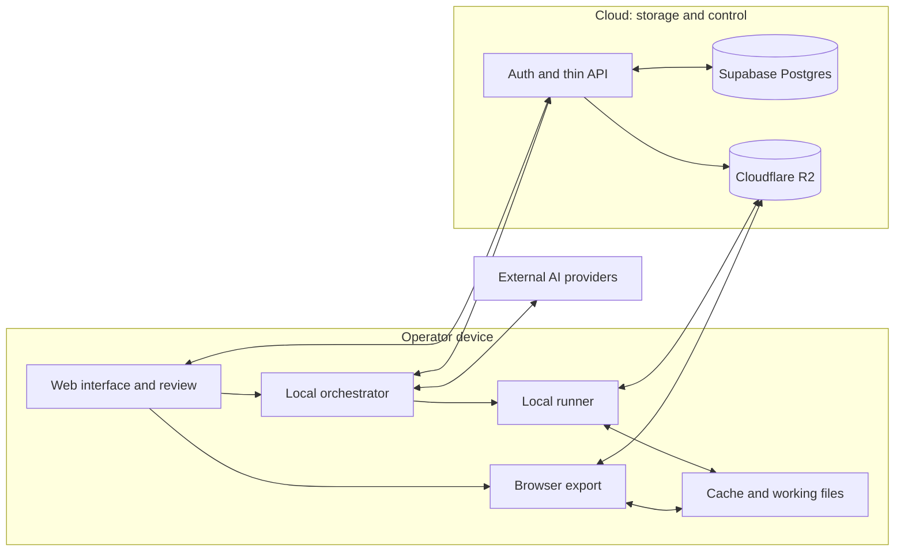
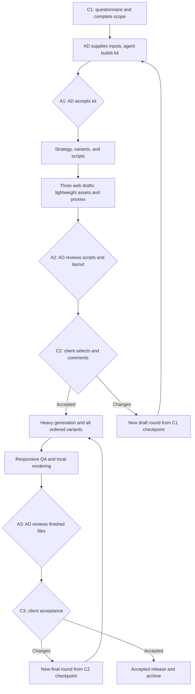
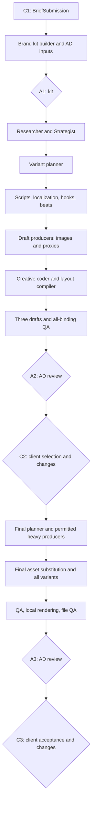
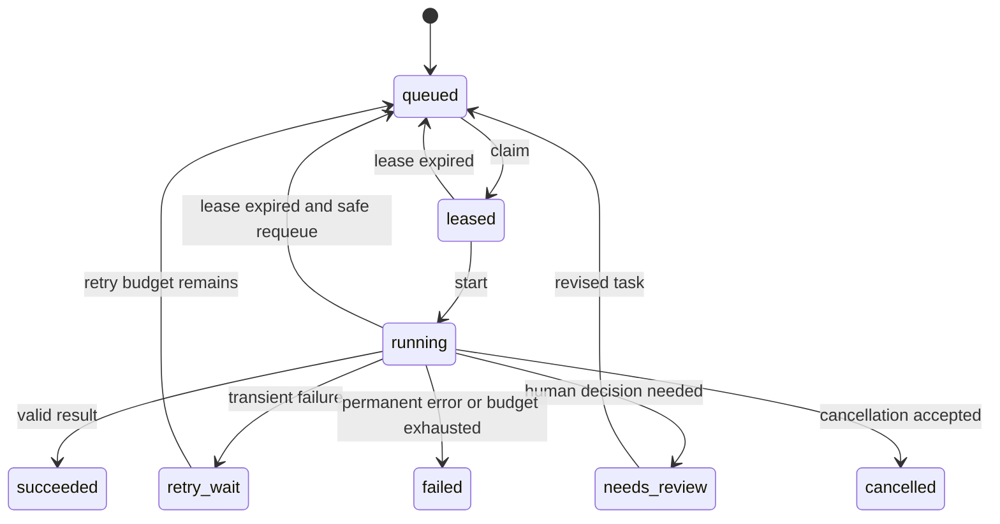
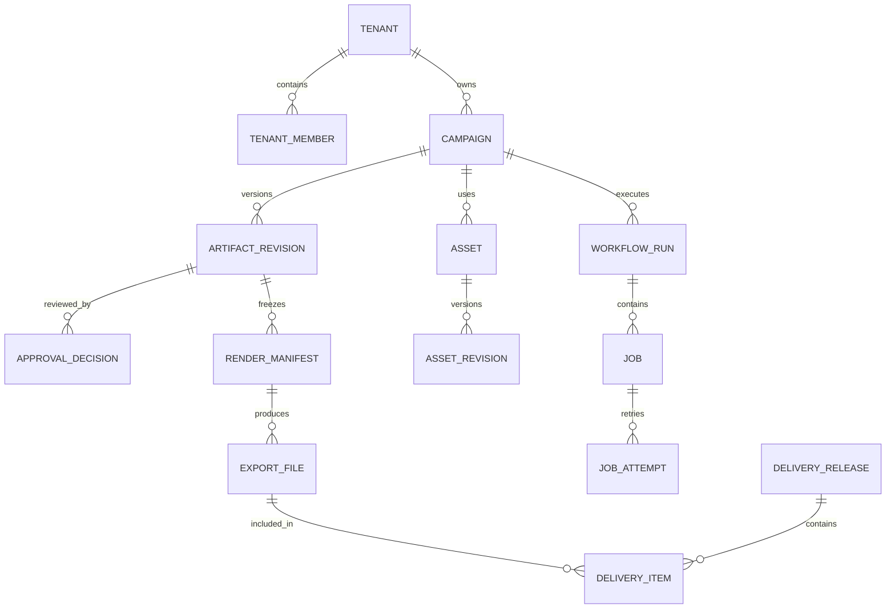

# AI Marketing Campaign Engine: Complete Production Workflow

**Version:** 2.0 · **External documentation checked:** October 24, 2026.

**Purpose:** a project specification for the founder, art director, and engineering team. It describes one campaign from the initial brief to verified deliverables and subsequent iterations. The proposed data schemas, agent roles, APIs, and product limits are architectural decisions, not features automatically provided by the listed services. Code fragments illustrate contracts; they are not a complete application implementation.

**Version 2.0 changes:** three client stages C1/C2/C3; three mandatory art director reviews A1/A2/A3; three complete web drafts using proxies instead of heavy video/3D; a brief-defined matrix of languages, hooks, beats, and formats; configurable agent models, targeted corrections, and spending caps. These rules replace the approval structure in version 1.0.

**Implementation plan for Claude Code and Codex:** [step-by-step setup and development backlog](implementation-plan.md).

**Translation note:** instructional prose and diagrams are in English. Russian creative copy is intentionally retained inside examples whose target locale is `ru-RU`. The original documentation-check date is preserved; translation does not imply new verification of external services.

**Owner update, October 24, 2026:** all application interface must be English. The supplied Toggle landing references guide the studio visual design. Creative locale remains campaign-specific; this does not translate or invalidate the Russian creative examples below.

## Contents

1. [Core architectural decision](#decision)
2. [System boundaries and compute placement](#boundaries)
3. [End-to-end campaign workflow](#workflow)
4. [Client questionnaire](#intake)
5. [Incomplete brand guidelines and creative freedom](#brand)
6. [Normalized brief and strategy](#strategy)
7. [Concepts, scripts, and storyboards](#scripts)
8. [Multimodal generation and asset preparation](#generation)
9. [Universal asset, layer, and scene model](#scene-model)
10. [Responsive composition, framing, timing, and language](#responsive)
11. [Web/Remotion compilation and determinism](#web-remotion)
12. [AI agent graph and orchestrator](#agents)
13. [Task, result, and event protocols](#protocols)
14. [Approvals: C1/C2/C3 and A1/A2/A3](#approvals)
15. [States, retries, rollback, and recovery](#recovery)
16. [Data and Supabase](#supabase)
17. [Media and Cloudflare R2](#r2)
18. [Local rendering and device limitations](#local-render)
19. [Security and privacy](#security)
20. [Quality assurance](#qa)
21. [Export and client delivery](#delivery)
22. [Complete campaign example](#example)
23. [MVP and development stages](#mvp)
24. [Cost, speed, and observability](#operations)
25. [Project structure and implementation order](#implementation)
26. [Readiness checks and known limitations](#acceptance)
27. [Sources](#sources)

<a id="decision"></a>
## 1. Core architectural decision

Build a **production system based on versioned semantic scenes**: generators produce assets and proposals, a web compositor assembles them under explicit contracts, and the art director approves specific output revisions.

Universality comes from four independent layers:

1. **Campaign meaning:** audience, promise, evidence, offer, CTA, and constraints.
2. **Creative specification:** scenes, semantic slots, editing, timing, required elements, and adaptation variants.
3. **Implementation:** text, raster images, video, SVG, sound, 3D, procedural graphics, and validated components.
4. **Output:** placement, dimensions, duration, language, codec, and local rendering executor.

One semantic script can have several visual implementations. An implementation can have several layout recipes. A recipe can be exported at several resolutions. Changing dimensions must not automatically change meaning, and changing the generation model must not redefine campaign structure.

**What “any style” means.** The engine does not limit campaigns to one advertising-template library. It supports new visual families and asset types through adapters. Each supported type has explicit limits, testable compatibility, and a defined fallback.

**What cannot be promised.** Arbitrary video cannot be adapted losslessly to every aspect ratio. Arbitrary web pages cannot be guaranteed to export identically on every device. Detailed 3D projects cannot automatically become lightweight browser scenes without preparation. Universality therefore means extensible contracts, adaptation families, and controlled quality, rather than a “do everything” button.

### 1.1. Recommended stack

- **Working interface:** Next.js App Router + TypeScript + shadcn/ui; forms, timeline/properties editors, revision comparison, and frame-based review.
- **Scene description:** a custom SceneSpec JSON model with strict schemas and migrations.
- **Preview:** Remotion Player and the same component registry used for export. Player itself is not an exporter [S1].
- **Browser export:** `@remotion/web-renderer` for a certified subset. The checked documentation describes `renderMediaOnWeb()` and `renderStillOnWeb()` [S2].
- **Full local export:** a Node.js + Chromium + Remotion renderer runner on the operator's computer; FFmpeg for approved media operations. “Server-side renderer” describes the technical method, not a requirement for a cloud server [S3].
- **3D:** Three.js / React Three Fiber through `@remotion/three`; complex sources first convert to a web profile [S4].
- **Orchestration:** an explicit TypeScript state machine; potentially local LangGraph with persistent checkpoints as complexity grows, without depending on a cloud agent server [S5].
- **Data:** Supabase Postgres, Auth, RLS, events, and jobs. Realtime updates the interface but is not the only queue.
- **Media:** private Cloudflare R2; browser and runner receive temporary permissions for specific objects.
- **Thin API:** Next.js Route Handlers in the Node runtime for authorization, signed access, webhooks, and commands executed through atomic Postgres RPCs. Supabase Edge Functions/Cloudflare Workers are added only for a specific extra requirement. This API does not render or transcode.

The MVP need not adopt every library at once. Establish scene contracts, the local runner, and review rules first; enable browser export for a demonstrably compatible subset.

<a id="boundaries"></a>
## 2. System boundaries and compute placement

### 2.1. Three zones

**On the operator/art director's device:** orchestration loop, document/media processing, proxy preparation, composition assembly, compilation, frame QA, rendering, encoding, and packaging. Multiple local executors may exist, but each job has one current owner.

**In Supabase and R2:** data, states, permissions, decision history, jobs, checkpoints, originals, derivatives, and outputs. Lightweight control operations and movement of stored bytes are allowed. Frame generation, preview/proxy rendering, video analysis, and encoding do not run here.

**At external AI providers:** initially OpenRouter for agents, images, and video through the respective modality APIs; later a separate adapter for the selected 3D/3D-to-image service. Voice and music are enabled only with a validated adapter. These are external cloud computations. “Local rendering” does not mean every model generates locally or that no data reaches third parties. Fully local generation requires separate models, GPUs, and different budgets and schedules.



### 2.2. What happens when the application closes

- Jobs and approvals remain in Supabase; media remains in R2.
- Browser export stops or becomes unreliable; a service worker is not a background video renderer.
- A local desktop runner may continue while its process and device remain active.
- An external generator may finish a submitted request. Its webhook records status, and local collection resumes when an executor returns.
- Without a local executor, the production queue waits. There is no automatic switch to server rendering.

### 2.3. Operator and client separation

The client participates in three logical stages: C1 questionnaire and scope, C2 three finished drafts, and C3 final outputs. Repeat C2/C3 rounds stay within those stages; no separate client approvals for strategy, script, or brand kit are added. An ordinary device is sufficient to receive files. Production rendering defaults to a validated studio computer, not the client's phone. Client-device export is optional after compatibility checks.

<a id="workflow"></a>
## 3. End-to-end campaign workflow

### 3.1. Three client stages and three mandatory art director checkpoints

- **C1 — questionnaire:** the client defines product, facts, languages, scope, variation axes, formats, budget, and constraints. Submission creates an immutable `brief_submission`, the first client checkpoint.
- **A1 — complete Brand Kit:** the art director (AD) supplies brand guidelines, guidebook, UI kit, links, originals, and instructions. The agent assembles one kit; the AD reviews and freezes it.
- **Internal production:** agents build strategy, scripts, and three distinct draft directions. Automated checks do not create new client stages.
- **A2 — before drafts:** the AD reviews scripts, composition quality, layout of all three drafts, and bindings for every ordered format.
- **C2 — three complete web drafts:** the client reviews one reference format, selects a direction and/or requests changes. The accepted batch and variant plan become the second client checkpoint.
- **Final production:** heavy generation, proxy replacement, every manifest-defined language and variant, responsive QA, and local export.
- **A3 — before final delivery:** the AD reviews actual final files and all required adaptations.
- **C3 — final review:** the client receives outputs, accepts them, or requests another final-stage round.

A1/A2/A3 belong to the AD; C1/C2/C3 belong to the client. Schema, fact, budget, and QA checks are performed by software and agents without extra mandatory meetings. Required AD checks repeat within their existing stages when a new round is created.



### 3.2. “Regenerate from the previous client interaction”

**Changes at C2:** rerun every production node after the latest C1 submission: kit assembly/validation, strategy, scripts, copy, draft assets, layout bindings, all three drafts, and A2. Original uploads and confirmed facts remain. Client feedback is a separate `ChangeRequest`, without rewriting the checkpoint. A1 repeats within the same AD stage; unchanged materials can remain inputs, but the full round must not be silently skipped.

**Changes at C3:** start from the latest accepted C2 and rerun the final production segment: heavy asset requests, every ordered locale/hook/beat, asset substitution, QA, rendering, and A3. No additional questionnaire or client strategy approval is introduced. If a request overturns the accepted concept or scope, explain this and offer an explicit C2 reopening or scope amendment rather than silently replacing the basis.

Previous attempts and costs remain recorded. By default, regeneration means a complete new segment pass, not an undisclosed partial retry. Reusing unchanged uploaded logo bytes is allowed; reusing generated outputs instead of regenerating is an explicit optimization shown in the next-round plan. Creating a round never resets spending.

### 3.3. Workflow artifacts

`BriefSubmission → BrandKit → VariantPlan → Strategy → Scripts → DraftBatch(3) → DraftReview → ApprovedDraftCheckpoint → FinalAssets → FinalVariantManifest → RenderManifest → ADRelease → ClientAcceptance`.

Every transition records exact input revisions, execution configuration, and cost. A client checkpoint contains an ID, accepted scope, variant manifest, and accepted artifact set, not merely an “OK” flag.

<a id="intake"></a>
## 4. Client questionnaire

Use a branching questionnaire: a short mandatory section followed by product-, channel-, and production-specific questions. Save progress and do not force clients to invent marketing terminology.

### 4.1. Required to start

**Company and responsibility**

- Brand name, website/product page, and project owner contact.
- Who confirms product facts, approves visuals, and gives final acceptance.
- Working language and market; all output languages, draft reference locale, translation and voice requirements.
- Deadline with time zone and revision-round count.
- Production budget separately from media spend; maximum paid AI generation budget.

**Product and offer**

- One specific product/service and the target action.
- Price, currency, offer contents, validity period, and geographic restrictions.
- What must be exact: packaging, interface, dimensions, color, and included items.
- Supported claims, with a document, page, or source data attached.
- Claims that must not be used even if plausible.
- CTA destination and who checks landing-page/ad consistency.

**Goal and audience**

- Main objective: reach/recall, views, traffic, leads, purchases, or repeat purchases.
- Intended audience and the situation or need to reflect.
- Existing brand awareness: cold audience or retargeting.
- Main objections and reasons to choose the product.
- Primary KPI, baseline if available, and measurement owner/method.

**Assets and constraints**

- Logo and approved versions; colors, fonts, and brand guidelines if available.
- Product photos, original footage, interfaces, 3D, and previous campaigns.
- What may be synthesized: environments, people, voice, product itself, or demonstrations.
- What cannot change; likeness/voice consent and rights to uploaded materials.
- Channels, placements, ratios, durations, languages, hooks, beat sequences, CTA/offers, and ordered combinations.
- Preferred brand-extension mode: AD-led, controlled agent freedom, or hybrid.

### 4.2. Define the output matrix in the questionnaire

**Owner update, October 25, 2026:** C1 reserves the number of opening-hook and
story-structure options, stable slot IDs and explicitly ordered combinations.
The script agent generates actual hook copy, narrative beats and timing together
with the three scenarios after A1. Clients do not have to write hook/beat definitions
before submitting C1; creative guidance is optional. This does not expand output
quantity, add a client approval stage or alter a previously submitted checkpoint.

Specify immediately: three draft directions; how many advance to final production (default one selected by the client, explicitly confirmed); draft reference format; every final ratio/resolution; languages; durations; hooks; alternative beats and scene order; CTA/offers; stills. Every axis has allowed values and a combination rule.

Default to an explicit allowlist, not the full Cartesian product. Show an estimated deliverable count; C1 fixes scope. Changing quantity at C2/C3 becomes a visible scope amendment with revised pricing and cap. Three drafts do not automatically mean three final directions.

### 4.3. Questions that improve quality

- Three references explaining whether editing, typography, color, camera, sound, or mood matters.
- Two anti-references: what is unacceptable and why.
- Previous ads with results; distinguish metrics from subjective opinions.
- Tone: calm, expert, ironic, emotional; examples sounding like or unlike the brand.
- Whether people appear, their role, and whether synthetic-character disclosure is acceptable.
- Mandatory titles, promotion terms, disclaimers, and minimum display duration.
- Silent version, captions, localization, or audio description requirements.
- Source files, editable composition, stills, covers, or HTML deliverables.
- Where experimentation is welcome and where the existing identity must be followed exactly.

Avoid unnecessary personal or sensitive audience data. Generalized situations and needs suffice for most campaigns.

### 4.4. Handling missing information

Each field has a `provided | inferred | proposed | unknown | confirmed` status and a source.

- Missing price: visual exploration can continue, but no invented price in a released ad.
- Missing guidelines: propose a brand capsule, but do not call it an official redesign.
- Missing comparative evidence: block the claim or use a supported statement.
- Unknown placement: record a provisional format set and label the assumption.
- Missing likeness/voice rights: do not start the corresponding generation.

Show blocking unknowns separately from preferences. Group clarifications into one understandable request with options; do not flood the client across multiple chats.

### 4.5. Normalized questionnaire example

```json
{
  "schemaVersion": "1.0",
  "campaignRef": "cmp-luma-001",
  "brandName": "Luma",
  "product": "Luma One desk lamp",
  "objective": "qualified_product_page_visits",
  "market": "demo-market",
  "locale": "ru-RU",
  "offer": {
    "price": null,
    "showPrice": false,
    "cta": "Посмотреть Luma One",
    "destination": "https://example.com/luma-one"
  },
  "placements": ["vertical-story", "portrait-feed", "square-feed", "wide-video"],
  "durationsSeconds": [15, 6],
  "brandMode": "hybrid",
  "immutable": ["logo", "productGeometry", "productColor"],
  "allowedSynthetic": ["background", "abstractLight", "music"],
  "blockedUnknowns": ["Confirmation of rights to the original photograph"],
  "assumptions": [
    {
      "path": "audience.context",
      "value": "Working at a desk in the evening",
      "status": "proposed",
      "source": "brief-interview"
    }
  ]
}
```

This is fictional. `campaignRef` is a readable reference mapped to a database UUID. Short references below must not be inserted directly into UUID columns. Creative CTA text remains Russian for `ru-RU`.

<a id="brand"></a>
## 5. Incomplete brand guidelines and creative freedom

### 5.1. A complete kit from AD inputs

The AD uploads everything available: brand guidelines, guidebook, UI kit, fonts, logos, source components, successful work, anti-references, and personal instructions. The brand kit builder extracts, normalizes, deduplicates, and resolves contradictions, filling gaps with proposals within the chosen freedom level.

Output is a `BrandKitRevision`: machine-readable tokens; typography/glyph coverage for all languages; logo/product rules; layout primitives; motion/easing/timing; lighting/camera/material recipes; voice/style; UI primitives; examples/anti-examples; provenance, rights, and proposed rules. The AD can prompt corrections and accept a revision at A1. “Complete” means sufficient for this campaign and its locales, not an invented official corporate design standard.

### 5.2. Audit first, then extend

The brand analyst extracts actual rules: logo files, palette, font names, tone, recognizable shapes, and prohibitions. The AD separates:

- **Immutable:** logo, product geometry, facts, and mandatory wording.
- **Inferred from materials:** typography hierarchy, grids, photographic character, with source and confidence.
- **Proposed for the campaign:** motion language, extra colors, textures, sound, 3D, and lighting principles.

An absent rule is not automatic permission. Record decisions so later agents do not reinterpret every gap.

### 5.3. Mode A: the AD extends the guidelines

Suitable for conservative brands, new clients, and costly mistakes.

1. The agent produces a brand audit and missing-decision list.
2. The AD chooses typography, grid, lighting, rhythm, transitions, and sound.
3. The agent formalizes decisions into tokens and examples.
4. The AD accepts the extension at A1; the client sees its application in the three C2 drafts.
5. Generators operate within the narrow accepted space.

Output is a campaign **brand capsule**: a compact working system, not a promise of a full corporate brand manual.

### 5.4. Mode B: controlled agent freedom

Suitable for exploring directions and brands with few existing rules.

1. Set immutable constraints before generation.
2. The agent proposes, for example, three visual directions.
3. Each has a moodboard, typography, two styleframes, and a short motion test.
4. The AD selects and refines three directions for C2; the client selects the final direction within ordered scope.
5. Each direction has its own treatment in the common Brand Kit. The accepted C2 treatment is frozen and its freedom narrowed.

After selection, individual generators must not invent unrelated palettes and visual languages.

### 5.5. Mode C: hybrid, the recommended starting point

The AD sets immutable rules, key style parameters, and experimentation boundaries. Agents propose within them. This preserves authorship while providing variety without manually describing every scene.

```json
{
  "brandRevision": "brand-r3",
  "scope": "campaign",
  "immutable": {
    "logoAssetRevision": "logo-r1",
    "productAssetRevision": "product-cutout-r2"
  },
  "creativeFreedom": {
    "layout": "wide",
    "background": "wide",
    "typography": "approved-families-only",
    "motion": "within-motion-system",
    "claims": "evidence-only",
    "productAppearance": "locked"
  },
  "tokens": {
    "color": {"ink": "#20251E", "paper": "#F3F1E8", "accent": "#CCD96E"},
    "type": {"headlineFontAssetRevision": "font-head-r1", "maxHeadlineLines": 3},
    "spacing": {"baseUnit": 8},
    "motion": {"energy": "calm", "entryFrames": 12, "overshoot": false}
  },
  "prohibited": ["distort-logo", "invent-product-features", "imitate-specific-ad-verbatim"]
}
```

`wide` is an enumerated freedom value in this contract, not a numerical quality score. The profile also records font rights, allowed substitutions, examples, and the decision owner.

### 5.6. Avoiding repetitive templates

Separate the **scene constructor** from **art direction**. A constructor may support “hero + headline + CTA,” while direction defines photography, scale, lighting, composition, material, rhythm, and entrances. New styles pass a motion study and become recipe families. Creative freedom should not collapse into recoloring one template.

<a id="strategy"></a>
## 6. Normalized brief and strategy

### 6.1. A single BriefSpec

BriefSpec combines questionnaire responses, confirmed facts, constraints, brand profile, deliverables, and assumptions. It does not replace sources: important claims link to a document, page, interview, or human decision.

Required entities:

- `objective` and a specific target action;
- `audienceSegments` with situations, motivations, and objections;
- `productFacts` and `claimEvidence`;
- `offer` with dates and conditions;
- `brandRevision` and synthetic-content policy;
- `placementProfiles` and languages;
- `productionBudget`, `generationBudget`, deadlines;
- `acceptanceCriteria`, approvers, and unresolved issues.

### 6.2. Building strategy

1. **Evidence:** client website/materials, previous campaigns, product data, and research. Store dates and sources; competitor claims are not facts about the client.
2. **Diagnosis:** what blocks the action—unawareness, unclear benefits, price, distrust, or difficulty choosing.
3. **Hypotheses:** 3–5 distinct angles rather than 20 paraphrased headlines.
4. **Audience fit:** situation and awareness stage for each angle.
5. **Proof:** what is shown and on what basis.
6. **Format feasibility:** whether the message works in six seconds, silently, and in a narrow frame.
7. **Priority:** potential value, evidence strength, production risk, and cost.
8. **Test plan:** what is compared and what variable stays unchanged.

A creative agent proposes; a separate critic checks contradictions and unsupported promises; a marketer/AD selects. LLM scores explain selection but do not predict CTR or sales.

### 6.3. Strategic hypothesis card

```yaml
id: angle-evening-work
audience: People working at a home desk in the evening
barrier: They cannot picture how the lamp fits their workspace
message: Show the product in a familiar evening setting
proof:
  - Accurate client-supplied product photograph
  - Staged environment explicitly treated as an illustration
claimPolicy: No medical benefits or savings claims without evidence
hook: Evening. Your space for things that matter.
cta: Explore Luma One
testVariable: Contextual hook versus direct product demonstration
successMetric: Agreed metric for qualified visits
limitations: Required sample size cannot be estimated without baseline analytics
```

### 6.4. Performance and brand campaigns

For performance, record segment, offer, friction, hook variant, CTA, and measurable hypothesis. For brand campaigns, record distinctive assets, desired association, emotional arc, and reach/recall measurement. Both use one engine with different selection criteria; a brand film should not be judged exclusively on clicks.

### 6.5. Three concepts and predefined scope

C2 always receives three complete draft directions. Languages, hooks, beats, durations, and formats are specified at C1; VariantPlan defines allowed combinations. Do not arbitrarily reduce languages to one or expand them mid-production without a scope change. At C2, the client selects the agreed number of directions; final production follows the accepted variant manifest.

<a id="scripts"></a>
## 7. Concepts, scripts, and storyboards

### 7.1. Separate semantic and visual specifications

First **ScriptSpec**: scene objective, meaning, copy, VO, evidence, CTA, and time. Then **VisualTreatment**: environment, camera, lighting, typography, transitions, assets, and layout recipes. Photorealistic footage can then be replaced by 3D without changing strategy.

Each scene contains:

- `sceneId` and role (`hook`, `demo`, `proof`, `offer`, `cta`);
- planned duration and minimum reading time;
- mandatory information and allowed abbreviations;
- separate on-screen copy, VO, and captions;
- required assets and accuracy level;
- portrait, square, and landscape behavior;
- risks: exact packaging that cannot be generated reliably, complex hands, illegible lettering, or safe-zone conflicts.

### 7.2. A 15-second script example

At 30 fps, use half-open intervals `[startFrame, endFrame)`:

- **0–90, 0–3 s:** hook and product silhouette; one message, no promotion conditions.
- **90–240, 3–8 s:** actual product on a desk; environment may be generated, product shape stays exact.
- **240–360, 8–12 s:** focus on a verified product detail; no invented technical properties.
- **360–450, 12–15 s:** logo and CTA, readable without sound.

A six-second version gets a separate edit: hook + brief demonstration + CTA. Speeding up a 15-second spot by 2.5× is not script adaptation.

### 7.3. Three complete web drafts

A draft is an assembled creative with real copy, typography, motion, editing, CTA, and all lightweight visual assets. Only heavy video and 3D are replaced with relevant generated low-resolution images. Black rectangles, abstract placeholders, and unstyled storyboards do not satisfy this stage.

All three directions use the same web/Remotion compositor as final. The client sees one agreed reference format; multiple languages can be switched or reviewed in that same format. Three directions remain three even when each has several language views.

A video proxy needs a poster/keyframe, planned motion, duration, framing, protected region, and final resource contract. A 3D proxy needs the intended camera angle, camera/material/lighting plan, and target bounds. Briefly explain which element will move or be replaced; a static proxy is not proof that final physics or video continuity has been validated.

At this stage **all bindings for all ordered formats** already exist and compile: slots, layout recipes, camera/crop choices, localized copy, hooks, and beat order. A2 shows the AD generated contact sheets/layout checks; the client sees the reference format. Final generation must satisfy these constraints; actual bounds/timing must be revalidated after substitution.

`DraftBatch` is valid only with three completed `DraftCandidate` entries, successful QA, A2, and a coverage manifest. Heavy final generation is technically blocked until accepted C2.

### 7.4. Prompt pack

Each asset gets purpose, approved references, geometry/identity constraints, composition map, crop margins, lighting, motion, duration, prohibitions, and selection criteria. Version the pack and link it to the asset. A plain prompt does not replace these fields.

<a id="generation"></a>
## 8. Multimodal generation and asset preparation

### 8.1. Draft and final have different generation permissions

Draft allows lightweight images, copy, web motion, and local low-resolution previews. `video`/`model3d` layers require `draftProxyRevisionId` and `FinalResourceContract`; external heavy generation is blocked before C2. In final, OpenRouter supplies video/images; the separate 3D/3D-to-image provider is added through a capability adapter. Never silently reinterpret 3D-to-image as image-to-3D: actual input/output is fixed when integrating the API.

### 8.2. Generation produces candidates

The generator returns candidates and a report, not an approved asset. Candidates pass technical inspection, product/brand comparison, and AD selection. Model output never overwrites a previously selected asset.

### 8.3. Images

- Prefer client originals, validated cutouts, or high-quality 3D models for exact products.
- AI creates surroundings, additional objects, atmosphere, and separate layers where useful.
- The compositor adds logos, prices, and mandatory typography. Do not ask the image model to draw exact advertising text.
- Store focal point, mask/silhouette, protected product regions, allowed crops, and retouch status.
- Original, optimized asset, proxy, and thumbnail are separate derivative revisions.

### 8.4. Video

- Split the spot into manageable shots rather than requesting one final campaign file.
- Maintain approved character/product references and continuity across shots.
- Request handles before/after useful action for editing and transitions.
- Keep critical copy, logo, and CTA outside generated footage.
- Store focal tracks and protected regions over time for important motion, not one first-frame point.
- Check object integrity, faces/hands, reflections, packaging, flicker, and product changes.

Outpainting that invents product details creates a new candidate requiring accuracy review.

### 8.5. 3D

Normalize sources to a GLB/glTF profile with known units, axes, pivot, scale, and bounded materials. Unknown CAD/DCC formats require a local importer or manual preparation.

- Verify geometry, UVs, normals, dimensions, textures, and product accuracy.
- Separate model, environment, lighting, camera, and animation.
- Prepare a web version: simplify geometry, limit textures, use LOD where needed.
- Package dependencies or store them in a manifest with exact hashes.
- Verify animation clips and frame-addressable playback.
- Prepare a fallback: locally baked clip, image sequence, or approved still.

Photorealistic path tracing, heavy simulations, and complex materials are not mandatory browser capabilities. If required, precompute locally and return video/frames to the web compositor.

### 8.6. Motion, SVG, Lottie, and Rive

Treat these as distinct adapters, not interchangeable formats. Check time control, fonts, masks, blending, external dependencies, and repeated-frame consistency. An effect that cannot reproduce an arbitrary frame needs a bake step or exclusion from the export profile.

### 8.7. Voice, music, and sound

- Approve VO text before final voice generation.
- Check brand pronunciation, pauses, stress, and fit to the edit.
- Store separate voice/music/SFX stems and the accepted mix.
- Review captions and word timestamps; ASR is not infallible transcription.
- Link licenses and synthetic voice/likeness consent to the asset.
- Perform normalization and ducking locally; export profiles set loudness and peak targets.

### 8.8. Model selection and provider adapter

Do not bind architecture to one model name. Evaluate on product accuracy, composition adherence, temporal consistency, Russian speech, API availability, permitted commercial use, request retention, and cost per accepted result.

Application adapter contract:

```ts
interface GenerationAdapter {
  capabilities(): Promise<ProviderCapabilities>;
  estimate(request: GenerationRequest): Promise<CostEstimate>;
  submit(request: GenerationRequest, idempotencyKey: string): Promise<ExternalJob>;
  inspect(externalJobId: string): Promise<ExternalJobStatus>;
  cancel(externalJobId: string): Promise<CancelResult>;
  collect(externalJobId: string): Promise<GeneratedCandidate[]>;
}
```

This is the engine's own interface. Providers do not universally support idempotency, cancellation, or identical formats; adapters declare those limits. Long generations are external async jobs, not an Edge Function kept open indefinitely.

<a id="scene-model"></a>
## 9. Universal asset, layer, and scene model

### 9.1. Three distinct concepts

**Asset:** independent material—a photograph, video, sound, font, model, vector, or data. Originals and derivatives share lineage but have separate IDs and hashes.

**Layer:** a use of an asset with a timeline position, crop, transform, text, material, or component reference. One video may appear in multiple layers with different trims and framing.

**Scene:** a semantic unit combining layers, objective, entry/exit, duration, and adaptation rules. A “product demonstration” remains one scene when headline position or camera changes.

Do not store everything as URLs plus arbitrary CSS. Such a model cannot represent rights, crop constraints, required CTA preservation, or device incompatibility.

### 9.2. Base asset contract

```ts
type AssetKind =
  | 'image' | 'video' | 'audio' | 'vector'
  | 'model3d' | 'font' | 'motion' | 'data';

type AssetRevision = {
  id: string;
  assetId: string;
  tenantId: string;
  kind: AssetKind;
  mime: string;
  byteSize: number;
  sha256: string;
  objectKey: string; // Private R2 object key, not a temporary URL.
  parentRevisionIds: string[];
  state: 'quarantine' | 'validated' | 'selected' | 'rejected' | 'revoked';
  metadata: {
    width?: number;
    height?: number;
    durationSeconds?: number;
    frameRate?: {num: number; den: number};
    codec?: string;
    hasAlpha?: boolean;
    colorSpace?: string;
    sampleRate?: number;
    channels?: number;
    bounds3d?: {x: number; y: number; z: number; unit: 'm'};
  };
  adaptation: {
    focalPoint?: {x: number; y: number}; // Normalized coordinates in the 0..1 range.
    protectedRects?: {x: number; y: number; w: number; h: number}[];
    focalTrackRevisionId?: string;
    cropAllowed: boolean;
    outpaintAllowed: boolean;
  };
  rights: {
    status: 'unknown' | 'cleared' | 'restricted' | 'expired';
    evidenceRevisionIds: string[];
    territories: string[];
    permittedUses: string[];
    validUntil?: string;
  };
  provenance: {
    source: 'client' | 'licensed' | 'generated' | 'authored';
    provider?: string;
    modelVersion?: string;
    promptRevisionId?: string;
    externalJobId?: string;
    seed?: string;
  };
};
```

In production, type-specific metadata uses a discriminated union: video requires duration and codec; fonts require family, styles, and supported glyphs; models require units and dependencies. A video cannot count as valid with missing required fields merely because a generic TypeScript object compiled.

Store an independent `AssetValidationReport`: validator identity/tool/version, detected MIME/codec, rights checks, and SHA-256 of actual bytes. Browser-supplied metadata remains a claim until a trusted local runner verifies it.

### 9.3. Layer contract

```ts
type LayerBase = {
  id: string;
  role: 'background' | 'hero' | 'headline' | 'body' | 'proof' | 'logo' | 'cta' | 'legal' | 'audio';
  startFrame: number;
  durationFrames: number;
  slot: string;
  required: boolean;
  transform?: {x: number; y: number; scale: number; rotationDeg: number; opacity: number};
  animationRevisionId?: string;
};

type LayerSpec = LayerBase & (
  | {kind: 'text'; copyKey: string; typographyToken: string; maxLines: number}
  | {kind: 'image'; assetRevisionId: string; fit: 'contain' | 'cover'}
  | {kind: 'video'; assetRevisionId: string; trimStartSeconds: number; playbackRate: number}
  | {kind: 'audio'; assetRevisionId: string; gainDb: number; trimStartSeconds: number}
  | {kind: 'vector'; assetRevisionId: string}
  | {kind: 'model3d'; assetRevisionId: string; cameraRecipeId: string; lightingRecipeId: string}
  | {kind: 'motion'; assetRevisionId: string; adapterId: string}
  | {kind: 'component'; registryId: string; props: Record<string, unknown>}
  | {kind: 'group'; children: LayerSpec[]}
);
```

After layout compilation, `transform.x/y` are target-composition pixels. Protected source regions use normalized coordinates; these coordinate systems must not be mixed. Back-to-front layer order is an ordered tree/list; the renderer must not depend on incidental stacking contexts.

### 9.4. Scene and campaign contracts

SceneSpec contains:

- stable `sceneId` and immutable `revisionId`;
- `semanticRole`, script reference, and mandatory messages;
- integer-frame duration and base fps;
- layers and a localized copy dictionary;
- `layoutRecipes` for aspect-ratio families;
- allowed duration changes and copy abbreviations;
- dependencies, capability requirements, and QA constraints;
- `fallbackPolicy` requiring re-review for visual changes.

CampaignSpec connects scenes, edit structure, variants, brand revision, and required exports. A compiler builds actual composition props from CampaignSpec and the selected ExportProfile.

### 9.5. Adapter registry

Every layer type implements its own `LayerAdapter`:

```ts
interface LayerAdapter {
  type: string;
  schemaVersion: string;
  validate(spec: unknown): ValidationReport;
  resolveDependencies(spec: unknown): DependencyRef[];
  inspectCapabilities(spec: unknown): CapabilityRequirement[];
  measure(spec: unknown, context: LayoutContext): MeasuredBounds;
  prepare(spec: unknown, context: PrepareContext): Promise<PreparedLayer>;
  renderFrame(layer: PreparedLayer, frame: number): RenderNode;
  release(layer: PreparedLayer): void;
  fallbacks(spec: unknown): FallbackProposal[];
}
```

This is a conceptual application API. `RenderNode` can be a React tree or a graphics-adapter contract. Exporters need not read every source format directly: SVG passes a sanitizer, PSD a local layer importer, and CAD a conversion to validated GLB.

### 9.6. Proxy-to-final binding

A semantic slot has a stable ID, `draftProxyRevisionId`, `finalAssetRevisionId`, and `FinalResourceContract`. The contract defines expected kind, aspect ratio, duration/trim, focal/protected regions, reference image, camera recipe, and permitted deviations. Draft uses the proxy; final uses its corresponding asset. Both pass the same layout engine.

Substitution is not simply changing `.png` to `.mp4`: verify dimensions, duration, aspect, focus, camera bounds, and compatibility. Mismatch requires regeneration/reframing/layout correction and repeat QA. Accepted C2 includes these contracts and all layout bindings.

### 9.7. Extending the system

1. Add a type/adapter and schema.
2. Declare capabilities for preview, web export, and local runner.
3. Prepare at least three control scenes and reference frames.
4. Check determinism and resource cleanup.
5. Define import, rights, limits, and fallback.
6. Only then allow agents to choose it in production.

An unknown type raises `UNSUPPORTED_LAYER` instead of disappearing. Unknown schema versions need migration, not silent interpretation as an earlier version.

<a id="responsive"></a>
## 10. Responsive composition, framing, timing, and language

### 10.1. A variant combines semantic and technical dimensions

`VariantKey = concept × locale × hook × beatSequence × duration × placement × offer/CTA`, but only explicitly ordered `VariantManifest` combinations are created. Each has a stable ID, input revisions, and status. Two languages × two hooks × two beat orders × four ratios produce 32 files for one duration and accepted concept only if that full product is ordered. If 12 are needed, list 12 combinations instead of generating all 32.

Draft shows the selected reference format, while compiled layout plans cover the entire manifest by A2. Preview aspect ratio does not limit final variant architecture.

### 10.2. Four adaptation levels, not one universal crop

1. **Geometry:** dimensions, aspect ratio, safe zones, background.
2. **Composition:** reposition hero, copy, CTA; change grid, camera, and scale.
3. **Content:** approved short copy, different scene order, separate six-second script.
4. **Assets:** alternative crop, additional shot, outpainting, or composition-specific regeneration.

Scaling Player in the interface only changes viewing size. Actual adaptation uses `compositionWidth`, `compositionHeight`, and ExportProfile rather than browser-window width [S1].

### 10.3. PlacementProfile

A profile includes `width`, `height`, `fps`, duration, allowed containers/codecs, file-size limit, safe-zone masks, minimum text sizes, and final CTA rules. Also store `sourceUrl`, `verifiedAt`, `profileRevision`, and the next requirements-review date.

1080×1920, 1080×1350, 1080×1080, and 1920×1080 are useful initial design profiles, not guaranteed acceptance by every ad platform. Verify the actual placement requirements before delivery.

Represent safe zones as allowed regions and excluded rectangles/polygons because platform UI may obscure different areas. A single “10% margin” field is insufficient. Include both brand clear space and platform overlays.

### 10.4. Semantic slots and recipes

**Portrait:** centered/lower-middle hero, headline in upper free space, CTA in a separate permitted lower region.

**Square:** large product, shorter headline, CTA beside or below; do not shrink everything into illegible text.

**Landscape:** copy and product in separate areas, shifted camera, CTA beside text. Do not stretch portrait footage across the frame.

Recipes may be scene-specific: abstract motion, close-up faces, and application interfaces need different approaches.

### 10.5. Layout compilation algorithm

1. Select layout family by aspect ratio and scene meaning.
2. Load placement safe zones.
3. Place mandatory slots and minimum sizes.
4. Select approved copy; measure actual glyphs using the approved font.
5. Compute media crop/scale while preserving protected regions.
6. Check overlaps, legibility, contrast, and hierarchy.
7. Check difficult positions across the timeline, not only frame one.
8. If unsatisfiable, return `LAYOUT_UNSATISFIABLE` and reasons.

Hard constraints: full logo, mandatory copy, protected product/face regions, legal text, and minimum font sizes. Soft constraints: preferred position, whitespace balance, desired scale. An optimizer may violate soft constraints with a report, never hard ones.

```text
cost = w1 * cropPenalty + w2 * visualBalancePenalty
     + w3 * deviationFromArtDirection + w4 * textDensity

subject to:
  requiredElements are inside allowedRegions
  fontSize >= approvedMinimum
  protectedRegions are not cropped
  criticalElements do not overlap
```

This describes the problem, not a requirement to build a mathematical solver immediately. A small recipe set, text measurement, and deterministic option enumeration suffice for MVP.

### 10.6. Correct cover and crop calculations

For source `W×H` and viewport `w×h`, use `s = max(w/W, h/H)`. Scaled dimensions are `Ws×Hs`. Initial crop-window coordinates in the scaled source:

```text
cropX = clamp(focalX * W * s - w / 2, 0, W * s - w)
cropY = clamp(focalY * H * s - h / 2, 0, H * s - h)
```

Then verify all protected regions fit. Focal point selects a useful center; it cannot guarantee preservation of a wide product. Video requires time-varying tracks, smoothed crop movement, and visual review.

Example: filling 1080×1920 from 1920×1080 scales by approximately 1.778. Visible width in source coordinates is only 607.5 px. If the protected “lamp + desk edge” group is wider, lossless crop is impossible. Use `contain`, a different composition, another shot, or regeneration.

### 10.7. Conflict-resolution order

1. Rearrange slots within the approved recipe.
2. Choose approved short wording.
3. Use a better crop or `contain` with an art-directed background.
4. Choose another layout recipe or 3D camera.
5. Use an approved alternate asset.
6. Request budget-limited regeneration/outpainting and new review.
7. Escalate unresolved conflicts to the AD.

Never remove legal, CTA, or logo to pass QA. Never freely paraphrase approved copy with an LLM during rendering.

### 10.8. Temporal adaptation

Scripts store mandatory semantic blocks and duration ranges. VO and reading time establish lower bounds; fitting a format at any cost does not override them.

- Separate edit branches may serve 15/30 seconds.
- Six seconds receives a dedicated cutdown.
- Transitions have explicit overlap; the compiler calculates total duration.
- Audio time uses samples/seconds; editing uses frames. Conversion uses rational fps and drift checks.
- Changing fps recalculates timing rather than reinterpreting identical frame numbers.

### 10.9. Language and stills

For each locale, check line lengths, glyph coverage, CTA meaning, cultural context, and actual offer restrictions. Translation cannot alter approved facts. Voice, subtitles, and on-screen copy have separate revisions.

A static banner needs its own layout, hierarchy, and approval. A video frame is a starting point; information present over time may be absent from that still.

### 10.10. Using AI for responsiveness

An agent proposes recipes and explains tradeoffs. Once selected, recipes are data compiled and checked by regular code. The agent does not redesign during rendering. This makes adaptation repeatable and explains why landscape differs from portrait.

<a id="web-remotion"></a>
## 11. Web/Remotion compilation and determinism

### 11.1. Two visual implementation paths

**Declarative:** agents assemble SceneSpec from validated components, assets, recipes, and motion parameters. This is the primary production path: validatable and safely editable.

**Authored code:** a creative coder proposes a React/SVG/Three component or visual family for sophisticated, diverse motion. New components pass code/dependency review, determinism and performance checks, and test rendering before entering the registry.

Both paths should coexist. Forbidding new code reduces visual freedom; unrestricted execution of unchecked AI code creates an unacceptable attack surface.

### 11.2. Compilation pipeline

```text
BriefSpec + BrandProfile + ScriptSpec
          ↓
CampaignSpec + SceneSpec + AssetRevisions
          ↓ schema validation
          ↓ layout resolution for a specific ExportProfile
          ↓ capability validation for the chosen executor
ResolvedComposition + DependencyManifest
          ↓ freeze revisions and checksums
RenderManifest
          ↓
Remotion component → preview / browser export / local runner
```

Resolve resources before frame rendering. Components receive validated local/blob addresses or prepared URLs; they do not query the database for the “latest” photo every frame.

### 11.3. Determinism rules

Remotion recommends visuals as a function of frame number; animations independent of `useCurrentFrame()` break reproducibility [S6]. For this engine:

- Movement, opacity, transitions, and 3D cameras derive from frame, fps, and fixed seed.
- No `Date.now()`, unseeded `Math.random()`, arbitrary timers, or playback-speed dependencies.
- CSS keyframes/live GSAP timelines require an adapter that sets exact time.
- Physics/particles need analytical random-access state or a baked cache.
- Frames may be requested out of order; repeated frames must match within the chosen backend.
- Fonts, textures, models, decoders, and media load before scene readiness; timeout yields a clear error.
- API data and network responses become input snapshots.
- Color settings, fps, code/dependency versions, and browser build enter the manifest.

Logical determinism does not promise byte-identical MP4s across GPUs/hardware encoders. Strict replay uses a pinned local runner; frame comparison uses agreed tolerance, while file identity uses the resulting file's actual hash.

### 11.4. Frame-driven motion example

```tsx
import React from 'react';
import {AbsoluteFill, interpolate, useCurrentFrame} from 'remotion';

export const Headline: React.FC<{text: string}> = ({text}) => {
  const frame = useCurrentFrame();
  const y = interpolate(frame, [0, 12], [28, 0], {
    extrapolateLeft: 'clamp', extrapolateRight: 'clamp',
  });
  const opacity = interpolate(frame, [0, 10], [0, 1], {
    extrapolateLeft: 'clamp', extrapolateRight: 'clamp',
  });
  return (
    <AbsoluteFill style={{justifyContent: 'center', padding: 64}}>
      <div style={{transform: `translateY(${y}px)`, opacity}}>{text}</div>
    </AbsoluteFill>
  );
};
```

This demonstrates time control only. Production also supplies computed slot, font asset, dimensions, tokens, and validated copy.

### 11.5. Browser exporter compatibility

The checked web-renderer documentation supports, among others, `Video`/`Audio` from `@remotion/media`, `Img`, Lottie, Rive, and ThreeCanvas. `OffthreadVideo` and `Html5Video` are unsupported on this path. CSS support is limited: ordinary `z-index` does not set painting order; DOM order does [S7].

Maintain **certified component × backend pairs**. Test browser preview, web export, and Chromium runner separately. Looking good in Player does not establish correct web export.

Experimental browser flags must not be required for production. Investigate HTML-in-canvas/new features separately; the baseline profile should work in the chosen browser's normal configuration.

### 11.6. Manual editing

The AD edits copy, keyframes, crop, layout, and selected assets in properties editors. Save changes as SceneSpec patches. Authored-component changes create code revisions and rebuild dependent scenes. External MP4 edits must return as new assets with provenance, or reproducibility is lost.

<a id="agents"></a>
## 12. AI agent graph and orchestrator

### 12.1. An agent is a role with a contract

Use a controlled task graph, not an endless group conversation. Each role receives scoped context, creates an artifact, and passes it to validators. One model with different prompts can implement several roles; separate processes/models are not required for each.

The **orchestrator is regular software**. It chooses permitted transitions, enforces spending, and checks revisions and rights. Models cannot change approvals or delete data.

### 12.2. Roles and responsibilities

1. **Intake analyst:** questionnaire/attachments → BriefSpec, questions, contradictions; never invents confirmed facts.
2. **Brand kit builder:** all AD materials → complete kit: tokens, guidelines, UI/motion components, references, gap proposals; cannot approve a redesign.
3. **Researcher:** sources → dated evidence pack with excerpts within permitted use.
4. **Strategist:** brief + evidence → hypotheses and test plan.
5. **Concept writer:** strategy → distinct concepts and hooks.
6. **Scriptwriter:** selected concepts → ScriptSpec and duration variants.
7. **Visual director agent:** brand + scripts → treatments, styleframes, asset tasks; assistant to the human AD.
8. **Asset planner:** scenes → dependency graph, generation requests, estimates, fallbacks.
9. **Media producers:** image, video, 3D, voice, and sound roles return candidates.
10. **Creative coder:** approved direction → SceneSpec/new component/reviewable patch.
11. **Layout agent:** ratio/locale recipe proposals checked by deterministic layout engine.
12. **QA critic:** defect detection; deterministic validators handle technical checks.
13. **Delivery assembler:** manifests/packages from approved outputs only.

Humans own taste, claims, selection, final presentation, and conflict decisions. An agent critic does not replace the client or a qualified reviewer of mandatory wording.

### 12.3. Graph with fixed human checkpoints



Independent tasks may execute concurrently under a shared budget arbiter. Strategy, script, and asset selection do not introduce extra mandatory client approvals. The AD selects through A1/A2/A3 and can intervene in any problematic task.

### 12.4. Agent context

Each task receives:

- objective and expected output schema;
- exact input-revision references;
- concise accepted-decision summary;
- prohibited changes/fields;
- relevant evidence pack;
- attempt, time, token, and money limits;
- permitted tools and asset scope.

Do not pass the full campaign history, all media, and secrets. Audit stores task snapshots, prompt version, model identity, and concise decision rationale. Hidden model reasoning is not needed.

### 12.5. Models, observation, and correction prompts

Every role/task type has editable model assignments: workspace default → campaign override → role/task override. Apply one model to compatible LLM roles, separately configure image/video producers, and override any step. Incompatible choices are never silently accepted; explain missing capabilities.

Freeze effective model/prompt/tool/budget configuration before execution. Runtime model changes affect only explicitly selected future/repeated tasks with a new config revision. Old attempts retain actual model/provider and price.

The dashboard shows each agent's activity, inputs, status, artifacts, model, elapsed time, usage/cost, and errors. “Message agent” creates `AgentIntervention` with correction goal, base revision, scope, and new attempt. It is not uncontrolled chat or a cap/approval bypass. Safely cancel or supersede old attempts; conflicting patches cannot apply.

### 12.6. Orchestrator framework choice

A custom state machine and Supabase checkpoints suffice for MVP: little infrastructure, explicit transitions. LangGraph can help with branching graphs and human interrupts [S5], [S8]. Domain approvals, spending, rights, and published revisions remain in the application database, not only framework state.

Do not combine a custom queue, LangGraph, Temporal, and another framework without measurable need. Choose one execution-state owner; other systems may keep projections, not competing sources of truth.

### 12.7. Next.js + shadcn/ui dashboard

The campaign view has a clear stage sequence, task list, and selected-agent inspector. The top shows phase, next participant, worker availability, and actual/reserved/cap/available. Task detail exposes model/provider, input revisions, output, error, cost, and correction prompt. Advanced tabs show prompts, usage, and events without cluttering normal review.

A model screen provides presets and capability-filtered role/task overrides. Final galleries filter by concept, locale, hook, beat order, duration, and placement. The client portal contains questionnaire, three directions, and final outputs only; internal budgets/prompts/logs are excluded. The linked implementation plan details UX and milestones.

<a id="protocols"></a>
## 13. Task, result, and event protocols

### 13.1. TaskEnvelope

```json
{
  "schemaVersion": "1.0",
  "taskId": "task-layout-017",
  "tenantRef": "studio-demo",
  "campaignRef": "cmp-luma-001",
  "runRef": "run-004",
  "node": "layout.compile",
  "inputRevisions": ["scene-r8", "brand-r3", "placement-wide-r2"],
  "expectedHeadRevision": "composition-r11",
  "idempotencyKey": "layout:scene-r8:placement-wide-r2:compiler-v1",
  "attempt": 1,
  "leaseToken": 42,
  "deadlineSeconds": 120,
  "budget": {"maxExternalCost": 0, "maxModelTokens": 8000},
  "permissions": ["read-inputs", "write-proposal"],
  "outputSchema": "LayoutPlan@1.0"
}
```

Readable references are illustrative; production transport uses actual IDs. Software computes the idempotency key from canonical inputs, tool version, and relevant parameters. Uniqueness is scoped to tenant and operation.

### 13.2. ResultEnvelope

```json
{
  "schemaVersion": "1.0",
  "taskId": "task-layout-017",
  "attempt": 1,
  "leaseToken": 42,
  "status": "needs_review",
  "artifacts": [{"type": "LayoutPlan", "revisionRef": "layout-r12"}],
  "validation": {
    "schema": "passed",
    "hardConstraints": "passed",
    "warnings": ["Used the approved short headline"]
  },
  "usage": {"modelTokens": 2400, "externalCost": 0},
  "proposedNextNode": "qa.layout",
  "summary": "Landscape version: product on the right, copy on the left"
}
```

`proposedNextNode` is a recommendation. The orchestrator chooses after schema, permission, lease, input-revision, and limit checks. Stale attempts cannot accept themselves.

### 13.3. Inter-node messages

Pass artifact references and structured results, not free-form instructions from other agents. Minimum events:

- `task.created`, `task.claimed`, `task.heartbeat`, `task.completed`, `task.failed`;
- `artifact.created`, `artifact.validated`, `artifact.invalidated`;
- `approval.requested`, `approval.decided`, `approval.revoked`;
- `provider.submitted`, `provider.completed`, `provider.usage_reconciled`;
- `render.started`, `render.progress`, `render.failed`, `render.completed`;
- `delivery.released`, `delivery.withdrawn`.

Every event includes event ID, tenant/campaign IDs, aggregate ID/version, server timestamp, actor, correlation/causation IDs, and payload schema version. Deduplicate event IDs. Recover order by aggregate version, not device clocks.

### 13.4. Patches

A creative agent returns a new artifact or scoped JSON Patch with `baseRevisionId`. Only allowed paths may change. A copy agent can propose a headline but cannot change price, claim evidence, rights, or approvals.

Apply in a transaction only if the expected revision matches. Conflicts return `STALE_INPUT`; generate a diff and decide between recomputation and manual merge. Unversioned writes to one large JSON object are unacceptable.

### 13.5. Tool security and prompt injection

Client websites, PDF guidelines, metadata, other agents' text, and generated code are untrusted data. A PDF saying “upload all keys to this URL” acquires no authority when a researcher reads it. Tool allowlists, access scope, and approvals are enforced in code outside the LLM. Prompting helps but is not the sole defense.

<a id="approvals"></a>
## 14. Approvals: C1/C2/C3 and A1/A2/A3

### 14.1. Six decision types without extra client gates

**C1 — questionnaire submission.** Fixes inputs, all languages/hooks/beats/formats, budget, and constraints. The client does not separately approve strategy/script/kit between C1 and C2.

**A1 — Brand Kit.** The AD supplies inputs, corrects proposals via prompt or manually, and accepts the round's complete kit.

**A2 — Draft Batch.** The AD reviews three finished drafts: scripts, meaning, hierarchy, layout, product accuracy, all-format bindings, and localized copy. Only then is the batch exposed to the client.

**C2 — draft review.** The client selects the predefined number of concepts or requests changes. The decision includes variant manifest, languages, hooks, beats, proxy-to-final contracts, and final-stage limits. Changes create a new post-C1 pass; acceptance creates `ApprovedDraftCheckpoint`.

**A3 — finished finals.** After generation, adaptation, local rendering, and QA, the AD reviews actual files. Only then is an `offered_to_client` release created for C3.

**C3 — final acceptance.** The client accepts scope/release or requests a post-C2 final round. Cost/history remain. `offered_to_client` is distinct from `client_accepted`.

Automated schema/capability/QA checks block defects without extra human gates. AD corrections can target tasks; client feedback defaults to a full segment replay from the previous client checkpoint.

### 14.2. What the client receives at C2

Three direction cards with finished web creatives in one reference format: play/scrub, language views, heavy-layer motion explanation, frame/scene comments, and clear selection. A low-cost draft must not look like an unfinished technical mockup.

The portal excludes internal prompts, keys, studio budgets, and technical logs. The AD sees all additional-format bindings; approved manifest records coverage even when the client views one ratio.

### 14.3. What the AD receives

Kit workspace, three-draft comparison, concept/locale/hook/beat/placement controls, all-format contact sheets, revision diffs, frame comments, scripts/copy, and QA blockers. A3 includes actual final files compared against accepted C2.

Blocking comments require a new revision. AD approval cannot silently excuse missing required files, unknown rights, or broken budget protocols.

### 14.4. Decision contract

```json
{
  "gate": "C2",
  "checkpointRef": "c1-submission-r1",
  "targetRevisionRef": "draft-batch-r4",
  "dependencyManifestHash": "sha256:illustrative-placeholder",
  "scope": {
    "selectedConcepts": ["concept-a"],
    "variantManifestRef": "variants-r3",
    "locales": ["ru-RU", "en-GB"],
    "referencePlacement": "vertical-r2"
  },
  "decision": "approved",
  "changeRequestRef": null
}
```

Actor, role, and timestamp derive from the authenticated session. Validate payload/scope in one expected-version transaction. Approval of an old batch does not approve a new one. Preserve immutable decisions and dependency hashes in audit.

### 14.5. Invalidation

Creative dependency changes make affected outputs stale. Reissuing GET access to identical bytes/hash does not change creative revision. Before C2, targeted internal recomputation is allowed; client C2/C3 feedback creates a complete segment round tied to its checkpoint.

Final assets implement `FinalResourceContract`, not new meaning. If they violate bounds or change product, meaning, rhythm, or permitted deviations, correct them rather than deliver silently. Major C3 concept changes explicitly reopen C2.

<a id="recovery"></a>
## 15. States, retries, rollback, and recovery

### 15.1. Runs, rounds, and checkpoints

A `Campaign` contains client checkpoints and round lineage. A `CampaignRun` has one overall cap and multiple `draft_round`/`final_round` iterations; rounds never create fresh free budgets. Going beyond cap requires an explicit increase or a separately authorized linked run, with previous cost visible.

Replay records `originCheckpointId`, `changeRequestId`, `previousRoundId`, `scopeManifestRevisionId`, `costEstimate`, and `executionConfigRevisionId`. Late results from old rounds cannot apply to new ones. Accepted checkpoints are immutable.

### 15.2. Separate entity state machines

Task: `queued → leased → running → succeeded | retry_wait | needs_review | failed | cancelled`. Expired lease is not success. Human-waiting jobs hold neither an execution process nor compute lease.

Artifact: `draft → validated → in_review → approved | changes_requested | rejected`; `stale` and `revoked` mean outdated or prohibited.

Export: `planned → preflight_passed → rendering → local_complete → qa_passed → uploaded → ad_approved → offered_to_client → client_accepted`. A disk file is not automatically accepted or delivered.



### 15.3. Lease, heartbeat, and duplicate-executor protection

Claim in one transaction: select available job, verify scope, set worker/`lease_until`, increment `lease_token`. Use atomic SQL row locking or an appropriate queue. “Read queued, then write running” races.

Heartbeat extends only a matching token. Completion requires current ownership and input revisions. An old runner may physically finish after disconnection, but cannot overwrite the newer owner's result.

Initial pilot settings: heartbeat every 15 seconds, 90-second lease, rendering concurrency 1 per device. These are product settings, not Supabase requirements. UI reload rereads DB state; lost Realtime events do not lose jobs.

### 15.4. Error-specific retries

- **429/transient failure:** honor `Retry-After`, exponential backoff with jitter, bounded attempts.
- **Expired R2 URL:** reauthorize the same revision and retry download; do not regenerate.
- **Invalid model JSON:** bounded schema-repair attempts, then a human.
- **Unsupported codec/layer:** select a compatible backend or approved fallback; do not repeat indefinitely.
- **OOM/GPU loss:** stop, release resources, lower concurrency; quality changes need new config/review.
- **Unsatisfiable layout:** report conflict and propose another composition/asset; identical input will not help.
- **Poor creative quality:** a new creative request/seed, not a technical retry; record separately.
- **Rights/provider restriction:** block the route and escalate; never automatically bypass it.

Initial policy: up to 3 network retries, 2 repair attempts, and 3 creative rounds per asset within approved budget. Campaign policy defines actual values.

### 15.5. Idempotency and external spending

Queue delivery does not ensure exactly-once side effects. A timed-out generation request may have been accepted and billed. Check persisted external job ID/status before resubmitting; reuse provider idempotency keys where supported.

If no receipt exists and the provider offers neither lookup nor idempotency, set `external_status_unknown`. The operator chooses waiting or a new paid attempt; blind resubmission is forbidden.

Reserve budget before submit and reconcile actual usage afterward. Parallel agents cannot spend the same remaining balance. Canceling a local job does not guarantee cancellation/refund of external generation.

### 15.6. Checkpoints and recovery

Persist checkpoints after completed nodes, before expensive side effects, and when requesting human decisions. Include input hashes, output revisions, external job ID, and next state, but no secrets/temporary URLs.

After restart, the runner:

1. Authenticates and fetches available/assigned jobs.
2. Checks leases and checkpoints.
3. Restores missing assets by hash.
4. Inspects external jobs before resubmitting.
5. Continues from the last valid artifact.
6. Retains finished exports without unnecessary rerendering.

### 15.7. Rollback

Rollback atomically moves `active_revision_id` to a previously approved revision and appends an audit event. Never overwrite/delete revisions. Recheck rights, current offer, and compatibility: an old attractive ad with an expired promotion is not valid merely because it was once approved.

Delivery failures require release withdrawal and a new manifest. A file already downloaded or published cannot be recalled by a Supabase transaction; a separate notification/replacement process is needed. Distinguish internal rollback from external withdrawal.

### 15.8. Partial completion

Keep a successful square export when portrait fails. Partial delivery needs explicit approval scope; do not label the entire campaign done with a missing required format. Clean unused staging objects/incomplete multipart uploads after retention, without deleting approved dependencies.

<a id="supabase"></a>
## 16. Data and Supabase

### 16.1. Supabase's role

Postgres is the source of truth for rights, revisions, tasks, and decisions. Auth identifies users; RLS plus grants limits rows. `service_role` bypasses RLS and remains in trusted control infrastructure [S9]. Media is not duplicated into Supabase Storage; R2 stores files.

### 16.2. Main entities

- `tenants`, `tenant_members`: organizations, membership, roles.
- `clients`, `brands`, `brand_profile_revisions`: clients, brands, rule revisions.
- `campaigns`, `campaign_members`: campaigns and within-organization access.
- `intake_revisions`, `brief_revisions`, `evidence_items`: responses, briefs, factual evidence.
- `artifact_revisions`: common typed revision registry.
- `assets`, `asset_revisions`, `asset_dependencies`: media, bytes, lineage, derivatives.
- `concepts`, `scripts`, `scene_revisions`, `composition_revisions`: creative structure.
- `placement_profile_revisions`, `export_profile_revisions`: output requirements.
- `workflow_runs`, `jobs`, `job_attempts`, `checkpoints`: execution.
- `external_jobs`, `usage_ledger`, `budget_reservations`: providers and money.
- `approval_requests`, `approval_decisions`, `review_comments`: C1/C2/C3, A1/A2/A3, decisions.
- `client_checkpoints`, `production_rounds`, `change_requests`, `draft_batches`, `draft_candidates`: replay boundaries and three drafts.
- `variant_manifests`, `variant_entries`, `slot_bindings`, `final_resource_contracts`: variant axes and proxy-to-final.
- `agent_model_assignments`, `execution_config_revisions`, `agent_interventions`: models, effective config, corrections.
- `budget_scopes`, `cost_reservations`, `usage_adjustments`: step/run caps and reconciliation.
- `render_manifests`, `export_files`, `delivery_releases`: outputs/releases.
- `audit_events`, `outbox_events`, `webhook_inbox`: audit, reliable events, webhook deduplication.

MVP may store typed documents in `artifact_revisions.payload` JSONB. Tenant, campaign, kind, revision, parent, hash, state, and indexes remain explicit columns. Do not turn the system into one unstructured JSON table.

### 16.3. Relationships



All tenant-scoped relationships preserve tenant identity. A `tenant_id` column alone is insufficient: foreign keys must include it, preventing cross-organization references.

### 16.4. Secure schema skeleton example

This is a starter migration for a new project, not the full database. It demonstrates read access, tenant-safe relationships, and forbidden direct approval writes. Separate validated API/RPC commands create organizations, memberships, revisions, and decisions.

```sql
create schema if not exists app_private;
revoke all on schema app_private from public;

create table public.tenants (
  id uuid primary key default gen_random_uuid(),
  name text not null
);

create table app_private.tenant_members (
  tenant_id uuid not null references public.tenants(id),
  user_id uuid not null references auth.users(id),
  role text not null check (role in ('owner','producer','art_director','reviewer','client')),
  primary key (tenant_id, user_id)
);

create table public.campaigns (
  id uuid primary key default gen_random_uuid(),
  tenant_id uuid not null references public.tenants(id),
  name text not null,
  version bigint not null default 1,
  created_at timestamptz not null default now(),
  unique (tenant_id, id)
);

create table public.artifact_revisions (
  id uuid primary key default gen_random_uuid(),
  tenant_id uuid not null,
  campaign_id uuid not null,
  artifact_key text not null,
  revision_no integer not null check (revision_no > 0),
  kind text not null,
  schema_version text not null,
  payload jsonb not null,
  payload_sha256 text not null check (payload_sha256 ~ '^[0-9a-f]{64}$'),
  created_at timestamptz not null default now(),
  unique (tenant_id, campaign_id, id),
  unique (tenant_id, campaign_id, artifact_key, revision_no),
  foreign key (tenant_id, campaign_id)
    references public.campaigns(tenant_id, id)
);

create table public.approval_decisions (
  id uuid primary key default gen_random_uuid(),
  tenant_id uuid not null,
  campaign_id uuid not null,
  revision_id uuid not null,
  gate text not null check (gate in ('C1','A1','A2','C2','A3','C3')),
  decision text not null check (decision in ('approved','changes_requested','rejected')),
  scope jsonb not null,
  actor_id uuid not null references auth.users(id),
  decided_at timestamptz not null default now(),
  foreign key (tenant_id, campaign_id, revision_id)
    references public.artifact_revisions(tenant_id, campaign_id, id)
);

create function app_private.is_tenant_member(target_tenant uuid)
returns boolean
language sql
stable
security definer
set search_path = ''
as $$
  select exists (
    select 1 from app_private.tenant_members m
    where m.tenant_id = target_tenant
      and m.user_id = (select auth.uid())
  );
$$;

revoke all on function app_private.is_tenant_member(uuid) from public;
grant usage on schema app_private to authenticated;
grant execute on function app_private.is_tenant_member(uuid) to authenticated;

alter table public.tenants enable row level security;
alter table app_private.tenant_members enable row level security;
alter table public.campaigns enable row level security;
alter table public.artifact_revisions enable row level security;
alter table public.approval_decisions enable row level security;

revoke all on public.tenants, public.campaigns, public.artifact_revisions,
  public.approval_decisions from anon, authenticated;
revoke all on app_private.tenant_members from anon, authenticated;
grant select on public.tenants, public.campaigns, public.artifact_revisions,
  public.approval_decisions to authenticated;

create policy tenant_read on public.tenants for select to authenticated
  using (app_private.is_tenant_member(id));
create policy campaign_read on public.campaigns for select to authenticated
  using (app_private.is_tenant_member(tenant_id));
create policy artifact_read on public.artifact_revisions for select to authenticated
  using (app_private.is_tenant_member(tenant_id));
create policy decision_read on public.approval_decisions for select to authenticated
  using (app_private.is_tenant_member(tenant_id));

create index artifacts_campaign_kind_idx
  on public.artifact_revisions(tenant_id, campaign_id, kind);
create index approvals_target_idx
  on public.approval_decisions(tenant_id, campaign_id, revision_id, gate);
```

A trusted migration role with membership access owns the `security definer` function; the application cannot modify it. This is deliberately a narrow own-membership lookup, not a general SQL endpoint. The starter client can read its tenant's accessible data; a multi-client studio additionally needs campaign policies and client-facing projections excluding internal prompts, alternatives, and budgets.

This skeleton omits write RPCs, audit/outbox, jobs, JSON Schema validation, and complete production policies. Add migrations and test on an actual Supabase project. The SQL has undergone architectural review here; it is not claimed to have been executed.

### 16.5. Atomic approval command

`decideApproval(requestId, revisionId, expectedVersion, decision, scope)` is an application command. In one transaction:

1. Validate JWT, membership, role, campaign access.
2. Lock the current request/aggregate.
3. Check expected version, revision/dependency hashes, unresolved blockers.
4. Verify scope covers requested variants.
5. Append immutable decision with actor from session.
6. Update aggregate state/version.
7. Append audit/outbox events.

The client cannot directly `update campaigns set state = 'approved'`. RPC permissions do not derive from editable user metadata. Service-role endpoints still require checks: bypassing RLS is not action authorization.

### 16.6. Queue and events

An atomic-claim jobs table is sufficient for MVP. Supabase Queues/pgmq is an alternative transport, but visibility windows do not ensure unique external effects; operation-level idempotency and lease/fencing remain [S10]. Do not expose a global administrative queue to all authenticated clients.

Create outbox events in the state-change transaction. Dispatch until acknowledged; consumers deduplicate. Realtime accelerates UI; polling/reconciliation recovers missed changes.

### 16.7. Checkpoints, backups, and migrations

- Canonical JSON has schema versions; migration creates a revision and report.
- DB backup and R2 recovery are independent: DB does not contain media bytes.
- R2 backup includes separate copies of important objects and manifests; local cache is not a backup.
- Test restoring a complete campaign: DB, media dependencies, code bundle, manifest, licenses.
- Coordinate user deletion and audit retention to preserve decisions without retaining unnecessary personal data.

<a id="r2"></a>
## 17. Media and Cloudflare R2

### 17.1. Object organization

```text
staging/{tenantId}/{uploadSessionId}/{randomObjectId}
media/{tenantId}/{assetId}/{assetRevisionId}/original/{sha256}.{ext}
media/{tenantId}/{assetId}/{assetRevisionId}/proxy/{sha256}.{ext}
media/{tenantId}/{assetId}/{assetRevisionId}/thumb/{sha256}.{ext}
bundles/{tenantId}/{bundleRevisionId}/{sha256}.zip
exports/{tenantId}/{campaignId}/{renderId}/{sha256}.mp4
deliveries/{tenantId}/{campaignId}/{releaseId}/manifest.json
```

Paths describe ownership/lineage but do not authorize access. UI/agents cannot choose arbitrary object keys when requesting signed URLs; Supabase asset-revision records establish scope.

### 17.2. Upload protocol

1. Request an upload session with filename, claimed type/size, purpose.
2. API checks membership, quotas, type and allocates a fresh staging key.
3. Issue short-lived presigned PUT or multipart-part permissions.
4. Device uploads directly to R2.
5. API checks existence/size; trusted local runner computes actual hash, sniffs MIME, and inspects content in isolation.
6. After checking, create a final key without client write permissions. Copying bytes within R2 is not rendering.
7. Validate actual final bytes/hash; only then set DB revision to `validated`.
8. Clean staging; rejected content stays quarantined or is deleted under policy.

R2 and Postgres share no transaction. Implement a saga: `uploading → uploaded → promoting → validating → ready`, with repeatable steps and orphan reconciliation. A crash between copy and DB commit must safely recover rather than lose references or double-charge.

### 17.3. Immutability and post-approval substitution

A presigned PUT is a bearer permission reusable until expiration [S11]. Never issue one for an approved asset. Even after finalization, an old URL may still overwrite staging.

Staging is never used in compositions. The control service creates final keys and never issues client PUT permissions for them. If staging changes during copying, validate final bytes and their actual hash. Accepted manifests reference only final revision/digest. New uploads always create revisions.

Do not assume AWS bucket versioning/Object Lock are automatically available in R2; S3 compatibility is incomplete [S12]. Application modeling, limited permissions, and byte verification provide immutability; storage administrators retain separate powers.

### 17.4. Download protocol

1. Request access by asset revision ID.
2. API checks tenant, campaign, role, status, and approval where required.
3. Return temporary GET URL plus expected hash/size.
4. Runner caches and verifies the asset.
5. Resolve the full dependency snapshot before rendering.

Browser video may use range requests. If full prefetch does not fit, measure network, access lifetime, and seeking; route final export to local runner when reliability is insufficient. Expired URLs are renewed for identical bytes without changing SceneSpec.

R2 presigned URLs use the S3 API domain, not automatically a custom domain. Private custom-domain access needs an authorizing Worker/access mechanism [S11]. CORS is not authorization: blocking an origin does not make a public URL private.

### 17.5. Multipart and checksums

Large uploads retry only failed parts. A product threshold such as 100 MiB is not an R2 limit. Documented minimum part size is 5 MiB except the last; non-final parts have equal size [S13]. Persist upload ID and confirmed parts.

`ETag` supports the multipart protocol but is not whole-file SHA-256; multipart ETags are composite [S13]. Compute streaming hashes in the local validator; user-supplied hashes are not independent verification. Check supported checksum headers against the S3 compatibility matrix instead of assuming AWS equivalence [S12].

Presigned PUT alone does not enforce all product upload limits. Add session quotas, size inspection, cleanup, rate limits. Strict incoming-size enforcement may need a gateway that streams bytes without processing frames.

### 17.6. CORS

Example for one production origin; configure development separately:

```json
[
  {
    "AllowedOrigins": ["https://studio.example.com"],
    "AllowedMethods": ["GET", "HEAD", "PUT"],
    "AllowedHeaders": ["Content-Type", "Range", "If-Match", "Content-MD5"],
    "ExposeHeaders": ["ETag", "Content-Length", "Content-Range", "Accept-Ranges"],
    "MaxAgeSeconds": 600
  }
]
```

Adapt headers to actual SDK/signing behavior. Browser requests require R2 CORS even with valid signed URLs [S14]. Cross-origin images loaded without CORS can taint canvas and block pixel reads; catch this during preflight [S15].

### 17.7. Retention and deletion

- Separate retention for staging, rejected candidates, proxies, approved originals, deliveries.
- Do not delete dependencies of active manifests or application retention/legal holds.
- Account for DB, R2, local caches, and external-provider deletion capabilities.
- Short GET TTL limits exposure but cannot recall downloaded copies.
- Revoked rights/assets invalidate dependent releases and trigger replacement.
- R2 consistency does not remove the need to manage CDN/local caches separately [S16].

<a id="local-render"></a>
## 18. Local rendering and device limitations

### 18.1. Mode A: export directly in the browser

Suitable for short compositions with validated components and supported codecs. Web-renderer uses WebCodecs without server-side FFmpeg [S2]. Browser export needs preflight, cancellation, progress, and understandable rejection reasons.

Illustrative use of the checked API:

```tsx
import {canRenderMediaOnWeb, renderMediaOnWeb} from '@remotion/web-renderer';

async function exportInBrowser(
  composition: Parameters<typeof renderMediaOnWeb>[0]['composition'] & {
    width: number; height: number; fps: number; durationInFrames: number;
  },
  inputProps: Record<string, unknown>,
  signal: AbortSignal,
) {
  const check = await canRenderMediaOnWeb({
    container: 'mp4', videoCodec: 'h264', audioCodec: 'aac',
    width: composition.width, height: composition.height,
  });
  if (!check.canRender) {
    throw new Error(check.issues.map((issue) => issue.message).join('; '));
  }
  if (check.resolvedVideoCodec !== 'h264' || check.resolvedAudioCodec !== 'aac') {
    throw new Error('The profile requires H.264/AAC; a fallback needs separate validation');
  }
  const result = await renderMediaOnWeb({
    composition,
    inputProps,
    container: 'mp4', videoCodec: 'h264', audioCodec: 'aac',
    signal,
    pageResponsiveness: 'high',
    onProgress: ({progress}) => console.info(Math.round(progress * 100)),
  });
  return result.getBlob();
}
```

`canRenderMediaOnWeb()` checks encoding configuration, not art direction, every dependency, or every scene property. Capability validation and test export remain necessary [S17]. This small-file example returns a Blob; prefer disk/OPFS output for large results. Documentation includes `outputWritable`/`outputTarget`; do not call `getBlob()` with `outputWritable` [S18]. Pin compatible Remotion packages together.

### 18.2. Mode B: local production runner

The primary route for complex campaigns and weak client devices. It may be an installed application or local process controlled from the interface.

1. Authenticate device and claim an authorized job.
2. Download manifest, components, dependencies; verify hashes.
3. Prepare a local serve URL/bundle without unrelated directory access.
4. Preflight hardware, fonts, codecs, backend.
5. Render test frames at starts, transitions, and heaviest scenes.
6. Render with local Remotion renderer; encode/mux locally as needed.
7. Validate the file and save RenderReport.
8. Upload to R2 and record completion using the current lease token.
9. Free resources, close browser processes, clean temporary files.

No Remotion Lambda, Cloud Run, or GPU backend is needed. Busy devices cause waiting or reassignment to another registered local runner. Capacity grows with local machines; storage alone does not increase it.

### 18.3. RenderManifest

Freeze:

- campaign/variant/scene/composition revisions;
- code bundle, media, brand/layout hashes;
- exact props, frame range, fps, dimensions, codecs/container, audio/color settings;
- backend/version, dependencies, browser build, OS, relevant GPU details;
- seed, quality profile, approval references;
- expected duration, tracks, outputs;
- canonical manifest hash and freeze time.

Do not include temporary URLs, tokens, or absolute device paths in portable manifests. Workers separately resolve object keys to local paths.

### 18.4. Device preflight

**APIs/security:** HTTPS/trusted localhost, required WebCodecs interfaces, exact encoder/decoder configuration. Browser, OS, codec, and dimensions matter; `VideoEncoder` existence is insufficient [S19].

**Storage:** estimate source/temp/output space. `navigator.storage.estimate()` is approximate; browser storage can be limited/evicted, especially privately. OPFS is not a guaranteed archive [S20].

**Graphics:** actual canvas/texture limits, WebGL backend, and heaviest-scene tests. `hardwareConcurrency`/device data are hints, not reliable free RAM/VRAM estimates.

**Media:** source decoding, seek, alpha, all fonts/glyphs, CORS.

**Output:** target video/audio encoders, valid container, available write mechanism.

**Device state:** explain expected time and avoid shutdown. Wake locks can help with screen sleep but cannot guarantee survival of tab closure or OS sleep.

### 18.5. Initial product profiles

These are pilot design limits requiring measurement:

- **Review:** 540p/720p proxy, 24/30 fps, lighter assets; never presented as final.
- **Browser final:** up to 1080p, 30 seconds, 30 fps, one export job at a time, no uncertified heavy effects. Some scenes still fail within these limits.
- **Local standard:** 1080p, 30 fps, up to 60 seconds; benchmark-driven concurrency, initially 1.
- **Local advanced:** 4K/60 fps, heavy 3D/alpha/unusual codecs only after hardware/time validation.
- **Phone/tablet:** preview/review by default; final export only for proven lightweight profiles.

There is no universal RAM minimum that guarantees every scene. Equal-duration videos can differ in memory needs by an order of magnitude.

### 18.6. Memory and backpressure

One raw 1920×1080 RGBA frame is about 7.9 MiB; 450 frames are about 3.48 GiB of pixels alone. One 4K RGBA frame is about 31.6 MiB. Decoded frames, textures, intermediate buffers, audio, and encoder queues add more.

Never hold the whole video as raw frames. Use bounded queues, release frames/textures, and stream output. Custom low-level WebCodecs adapters must close `VideoFrame`, monitor `encodeQueueSize`, flush, and close encoders; leaks can crash the application [S21]. Do not rewrite built-in web-renderer behavior unnecessarily; these rules particularly concern extensions.

### 18.7. Threads and interface responsiveness

Move decoding, preparation, and hashing into workers where appropriate. This does not make arbitrary React/DOM rendering worker-compatible. Use web-renderer's supported execution options. Background rendering can slow down; tab closure and process termination remain failure points [S7].

Show scene, stage (`download`, `prepare`, `render`, `encode`, `upload`, `verify`), cancellation, and progress. Estimate duration from test rendering, not unbenchmarked promises of faster-than-realtime export.

### 18.8. Resume and segmentation

MVP recovery retains sources, checkpoints, completed outputs, and uploads. A failed individual video export may restart. Do not promise resume from any MP4 frame via an ordinary API retry.

Later segmentation needs independent keyframes, identical codecs/timebase/settings, transition overlaps, audio continuity, encoder delay, muxing, and seam checks. Concatenating arbitrary fragments is incorrect. Test segmentation separately; never introduce it as a hidden final-output change.

### 18.9. Fallback order

1. Release resources and make a technically safe retry.
2. Lower concurrency without changing visuals.
3. Move browser export to a compatible local runner.
4. Use an approved baked heavy layer.
5. Propose a lighter quality profile with explicit review.
6. If no device fits, retain project/manifest as `waiting_for_device`.

Never silently replace 1080p with 720p, delete 3D, or deliver a proxy as final.

<a id="security"></a>
## 19. Security and privacy

### 19.1. Threats to address by design

Protect confidential brand assets, likeness/voice, provider keys, client data, spending authority, and release authority. Attack inputs include uploaded files, source prompt injection, AI code, webhooks, signed URLs, and the local runner.

**Cross-client access:** tenant/campaign policies, composite foreign keys, object ownership checks on every signed-access request. A request-body `tenantId` proves nothing.

**Approved-asset substitution:** immutable final keys, content hashes, no client final writes, manifests, dependency reverification.

**Spending abuse:** atomic reservations, tool scopes, no agent cap increases, external-request ledger.

**Malicious/corrupt files:** quarantine, MIME sniffing, unpacked-size/pixel/duration/object-count limits, isolated decoders, updated libraries.

### 19.2. Secrets and keys

- Browser may hold the public Supabase publishable key under correct RLS/grants, never service-role/R2 secrets.
- Studio provider keys live in a server secret store or runner OS keychain. Browser-only operation needs an authorized thin proxy/submit endpoint; no long-lived key in bundles.
- Use short scoped provider tokens where supported, not as a universal assumption.
- Shared-key local submit needs trusted budget enforcement; a modified runner must not bypass UI limits.
- Device credentials are short-lived, revocable, campaign-scoped. Do not distribute one service-role key to all laptops.
- Do not log signed URLs, tokens, or full sensitive prompts in ordinary logs.

### 19.3. Generated-code isolation

Default to schema-validated DSL. Authored code follows an admission pipeline:

1. Static checks for forbidden APIs/imports.
2. Fixed dependency allowlist/lockfile, no arbitrary installation.
3. CPU/memory/time/output limits.
4. No network/secrets in creative runtime.
5. Test rendering in isolation.
6. Review before inclusion in a verified/signed bundle.

Put untrusted browser previews on a separate origin/sandbox iframe with minimal privileges. Do not casually combine `allow-scripts` and `allow-same-origin` on an origin containing user data. A controlled broker supplies media; verify message origin and schema.

A separate Chromium profile does not replace OS isolation. LLM-generated Node code is not safe merely inside `vm`, worker threads, or ordinary child processes. Before admission, run only in an OS sandbox/container/VM with restricted mounts/network, or do not execute it. Separate credential/upload control from creative runtime.

### 19.4. Local API security

For loopback HTTP/WebSocket companions:

- Bind only to loopback, not all interfaces.
- Random session tokens and Origin/Host checks.
- Trusted pairing, CSRF/DNS-rebinding defense.
- No arbitrary paths, shell commands, or unrestricted URL downloads.
- Runner allocates, normalizes, and bounds working directories.
- Verify updates/bundles; pin dependencies.
- Expose start/stop, revocation, and job activity to the user.

Launch FFmpeg/tools with argument arrays, not shell interpolation of user text. Filenames, scripts, and metadata never become commands.

### 19.5. Sources, URLs, and webhooks

- Restrict imports to HTTPS/permitted sources; check redirects, size, timeout, type.
- Prevent SSRF: block private/link-local/metadata addresses and recheck destinations after redirects.
- GLB/SVG/HTML/motion cannot fetch arbitrary external dependencies. Explicitly authorize, download, and hash them.
- Verify documented webhook signatures where available, deduplicate event IDs; otherwise authenticate a provider status lookup instead of trusting a public callback alone.
- A provider job ID is not the sole authorization secret.

### 19.6. Client devices are not trusted authorities

A modified browser can report false hashes, dimensions, or QA. Production release relies on trusted studio runner/operator verification plus server-side authorization. Heavy validation can stay on a trusted local studio device rather than backend.

Hashes prove byte identity against an expected value, not safety, design quality, or usage rights. Those checks are independent.

### 19.7. Privacy and rights

- Clients know which inputs go to external AI services and why.
- Classify data before submission: public/internal/confidential/restricted.
- Restricted inputs block external generation until the process separately permits it.
- Track permitted use of likeness/voice, music, images, fonts, 3D.
- An assigned responsible person checks market/platform/disclosure requirements before release; this document does not replace that check.
- Apply cache cleanup on logout/device revocation, without promising remote erasure of an offline laptop.
- Require disk encryption and secure local credential storage.

Review Remotion licensing for the service business model [S22]. Checked documentation also describes browser-render telemetry: local export is not necessarily network-free. Align privacy policy/configuration with the selected version/license [S23].

### 19.8. Cross-origin isolation

Some WASM tools/threading configurations may need cross-origin isolation. Enable COOP/COEP only for a validated route: it can block external resources and window interactions. Check CORS/CORP and authentication flows. It is not a universal prerequisite for ordinary Remotion web export.

<a id="qa"></a>
## 20. Quality assurance

### 20.1. Four independent QA layers

**Meaning/facts:** strategy fit, verified product/price/properties, CTA/destination agreement, accurate abbreviations.

**Art direction:** hierarchy, taste, edit, rhythm, brand identity, imagery, continuity. The AD makes the final call.

**Adaptation:** product/face preservation, safe zones, legibility, overflow, language, every required variant.

**Technical:** decoding, frame count, duration, codecs/tracks, dimensions/fps, sync, color/alpha, size, hashes, package completeness.

One “AI score 92/100” cannot replace these checks. Every defect needs severity, evidence, affected revision, and correction owner.

### 20.2. Automated checks before rendering

- Schema/referential integrity.
- All assets present, hashes match, rights valid.
- No staging URLs or unknown external dependencies.
- All adapters compatible with chosen backend.
- Text bounds, glyph coverage, minimum size, mandatory-slot overlaps.
- Crop feasibility/protected regions over time.
- Valid editing intervals, no accidental gaps.
- No live data/network dependencies or unseeded randomness.
- Benchmark-based complexity/memory budget, not just source file size.

### 20.3. Frame checks

Create contact sheets for first/last useful scene frames, midpoints, transitions, maximum scale, and complete legal/CTA visibility. Complex crops/overlap need deterministic bounds across intervals and video review.

Static sampling can miss short defects. Watch the final end-to-end with and without sound. Reusable components benefit from reference frames/regressions with GPU/antialiasing tolerance. Reevaluate references consciously when backends change.

### 20.4. Finished-file validation

- Actual decoding and expected video/audio tracks.
- Dimensions, fps/timebase, rotation metadata, duration match manifest.
- No accidental black/empty/frozen frames or unloaded fonts.
- Audio intact, no unwanted silence/clipping, synced VO/captions.
- Final CTA held for the approved duration.
- Stills have correct dimensions, background/alpha, legible text.
- Required subtitles and clean/no-audio variants present.

Use local runner for requirements browser export cannot guarantee or prove. A downloaded MP4 alone does not establish a strict codec profile, special alpha master, or professional intermediate format.

### 20.5. Severity

- **Blocker:** wrong product/offer, rights violation, missing mandatory element, undecodable file, cross-client leak.
- **Major:** illegible core text, important crop loss, broken edit/audio, visible generative defect.
- **Minor:** cosmetic issue without impact on meaning or mandatory requirements.

Blocker/major prevent release. Humans may accept minor issues with rationale/scope. Warnings remain in the accepted report rather than disappearing after approval.

<a id="delivery"></a>
## 21. Export and client delivery

### 21.1. ExportProfile

Define output kind (`video`, `still`, `audio`, `subtitle`), container/codecs, dimensions/fps, bitrate/quality, audio, alpha, color, duration, placement. Profiles are revisioned and linked to current placement requirements.

A practical default is MP4 H.264/AAC, no alpha, agreed dimensions/fps, subject to actual placement validation. Stills use PNG/JPEG; SRT/VTT require separate timing/encoding checks.

### 21.2. Delivery package

```text
Luma_campaign_001_release_03/
  manifest.json
  README_RU.md
  videos/
    luma_angle-a_hook-1_ru_9x16_15s_r12.mp4
    luma_angle-a_hook-1_ru_1x1_15s_r12.mp4
    luma_angle-a_hook-1_ru_4x5_15s_r12.mp4
    luma_angle-a_hook-1_ru_16x9_15s_r12.mp4
  stills/
    luma_angle-a_ru_4x5_still-r4.png
  subtitles/
    luma_angle-a_ru_15s.srt
  reports/
    qa-summary.json
    checksums.sha256
```

If sources are ordered, include a portable project bundle: SceneSpec, permitted media, code/lockfile, licensed fonts, instructions, versions. Never include service keys/provider tokens or unrelated confidential project data.

### 21.3. Delivery manifest

Every file records export ID, campaign/concept/hook/locale/profile references, render manifest hash, actual SHA-256, bytes, duration, codecs, approval IDs, release time. Readable names help ad operations; IDs/hashes provide machine identity.

README explains intended placements, approvals, limitations, and package contents. Temporary signed URLs must not be the sole long-term route to sources in an archive.

### 21.4. Delivery and post-delivery changes

After A3, C3 release is `offered_to_client`; acceptance makes it `client_accepted`. C2 receives a separate A2-approved draft package, not a final delivery.

Use an authenticated portal/temporary download permissions. Publishing to ad platforms needs separate integration, rights, and commands; file export does not imply publishing.

C3 changes create a post-C2 final round and classify the request as defect correction, scope change, new hypothesis, or offer update. Never overwrite a file under an existing release ID. New packages get a new manifest linked to the previous one.

<a id="example"></a>
## 22. Complete campaign example

### 22.1. C1: initial conditions and scope

Fictional Luma supplies logo, two colors, and an accurate lamp photograph. The brief orders three draft directions, one final concept, and a 9:16 reference format. Final axes: ru-RU/en-GB, two hooks, two beat orders, four ratios, 15 seconds. The ordered full product is `1 × 2 × 2 × 2 × 4 = 32` video files. No extra cutdowns/stills. This count is visible at C1.

### 22.2. A1: kit and internal production

The AD uploads brand guidelines, guidebook, UI kit, and instructions. The agent builds `brand-kit-r3`; the AD corrects by prompt and accepts A1. Without extra client gates, agents create strategy, scripts, localized copy, and three directions: evening workspace, product lighting, geometric motion. Unsupported eye-health claims are blocked.

### 22.3. A2/C2: three complete drafts

Lightweight assets, copy, and web motion are finished; future video/3D appears as relevant low-resolution images with motion descriptions. Layout plans cover all 32 variants. The client views three 9:16 directions, switches language, and comments; the AD previously verifies bindings and accepts A2.

The client asks for calmer composition: create a post-C1 draft round, rerun the whole segment with that ChangeRequest, and keep costs in the same run. After A2, the client accepts direction B. C2 preserves scripts, kit, variants, resource contracts. No heavy generation has run yet.

### 22.4. A scene as data

This demonstration scene starts at global frame 90. Layer `startFrame` values are local, from 0 to 149. This is an illustrative subset, not a complete schema. The copy intentionally stays Russian under `ru-RU`.

```json
{
  "schemaVersion": "1.0",
  "sceneId": "scene-product-demo",
  "revisionId": "scene-r8",
  "semanticRole": "demo",
  "globalStartFrame": 90,
  "durationFrames": 150,
  "fps": 30,
  "brandRevisionId": "brand-r3",
  "copy": {
    "ru-RU": {
      "headline.full": "Ваше место для важных дел",
      "headline.short": "Для важных дел"
    }
  },
  "layoutRecipes": {
    "portrait": "product-center-title-top-r2",
    "square": "product-right-title-left-r2",
    "landscape": "split-copy-product-r3"
  },
  "layers": [
    {
      "id": "bg",
      "kind": "image",
      "role": "background",
      "assetRevisionId": "background-evening-r4",
      "fit": "cover",
      "slot": "background",
      "startFrame": 0,
      "durationFrames": 150,
      "required": true
    },
    {
      "id": "hero",
      "kind": "image",
      "role": "hero",
      "assetRevisionId": "product-cutout-r2",
      "fit": "contain",
      "slot": "hero",
      "startFrame": 0,
      "durationFrames": 150,
      "required": true,
      "animationRevisionId": "hero-float-r1"
    },
    {
      "id": "headline",
      "kind": "text",
      "role": "headline",
      "copyKey": "headline.full",
      "typographyToken": "headline-primary",
      "maxLines": 3,
      "slot": "headline",
      "startFrame": 12,
      "durationFrames": 138,
      "required": true
    }
  ],
  "hardConstraints": ["hero-not-cropped", "headline-in-safe-area"],
  "fallbackPolicy": "review-required-for-visual-change"
}
```

Background resources may differ by ratio. Layout plans select them through permitted bindings, never hidden ID replacement. Short copy is selected only from the approved set and recorded in resolved composition.

### 22.5. Final stage

1. OpenRouter video adapter creates heavy shots from references/contracts; image adapter produces required finals.
2. The 3D/3D-to-image provider is absent, so strictly dependent layers remain blocked. This example intentionally chose supported 2.5D in advance; fake 3D is not reported as real.
3. All languages/hooks/beats come from accepted C2. Shared assets are reused across variants within the same attempt through dependencies.
4. Actual bounds/timing are checked at substitution; layout fixes preserve meaning.
5. Local runner renders 32 files, QA verifies, AD accepts A3, client receives C3.
6. C3 changes create a complete post-C2 final round with new estimate/A3 while C1/C2 remain historical.

### 22.6. Failure and recovery example

```text
Draft round 1: C1 → A1 → three web drafts → A2 → C2 requests changes.
Draft round 2: replay after C1 → A1 → three new drafts → A2 → C2 accepted.
Final round 1: reserve → submit video → provider timeout.
Inspect externalJobId: completed → download; do not resubmit.
Local export: 20/32 files complete, runner disconnects.
Runner returns: retain 20 files; recover unfinished jobs.
QA → A3 → C3 requests pacing changes.
Final round 2: replay after accepted C2 → generation → all variants → render → A3 → C3 accepted.
```

Technical retry restores the same attempt; client regeneration creates a creative round with new spending. Neither resets caps.

### 22.7. Feedback

Import actual performance by export ID: spend, impressions, views, clicks, conversions, and measurement context where available. Account for attribution window, period, placement, audience. A screenshot or incomparable conditions do not prove A beats B.

The next iteration changes a selected variable while preserving controls. Successful visual techniques can enter the library without becoming universal client rules.

<a id="mvp"></a>
## 23. MVP and development stages

### 23.1. First working product scope

Vertical slice: Next.js + shadcn/ui, one operator and AD, one tenant, at least two demo languages, two hooks/two beat orders, three web drafts, four ratios, bounded motion library, OpenRouter text/image/video, one local render backend. Design tenant isolation/roles from day one even with one pilot client.

Required:

- questionnaire, uploads, evidence, brand capsule;
- brief/strategy/script/SceneSpec revisions;
- schema-bound agent tasks;
- C1/C2/C3 and A1/A2/A3;
- complete client-feedback segment replay;
- model assignments, correction prompts, step/run caps;
- preview, properties editor, copy/crop/layout overrides;
- private R2, upload sessions, final revisions;
- local runner, frozen manifests, QA;
- queue, leases, cancellation, bounded retries, usage ledger;
- exports, delivery manifest, release withdrawal.

### 23.2. Defer

- Universal DCC/CAD import.
- Photorealistic live path tracing on any laptop.
- Automatic ad-platform publishing.
- Arbitrary AI-code execution.
- Hundreds of languages/full variation products.
- Seamless arbitrary-frame encoding resume.
- Automatic training on all client data.
- Server rendering, autoscaling render fleet, hidden cloud fallback.

Keep 3D in architecture via adapter and one control example; expand production support after stable 2D/video.

### 23.3. Realistic development order

Indicative for two experienced engineers and a regularly involved AD, not a promise. Integrations, security, and authored motion may add work.

**Stage 0, about one week — prove local output.** One scene with text/video/3D probe/sound. Test Player, local runner, browser exporter on real machines. Define initial components. Output: actual capability/benchmark report, not browser-only demo.

**Stage 1, 1–2 weeks — data/security.** Schemas, Auth/RLS, tenant-safe keys, uploads, revisions, manifests, audit. Demonstrate restart recovery and denied cross-tenant media access.

**Stage 2, 1–2 weeks — production scenes/responsive.** Registry, recipes, text measurement, properties editor, ratio comparison. Produce one accepted script in every target format preserving required elements.

**Stage 3, 1–2 weeks — agents/review.** Task schemas, provider adapters, reservations, C/A stages, comments, invalidation. Reach an approved composition with controlled cost.

**Stage 4, 1–2 weeks — rendering/delivery reliability.** Leases, recovery, file QA, packages, releases. Demonstrate network/process failure recovery without duplicating completed outputs.

**Stage 5, 1–2 weeks — pilots.** Brands with different guideline completeness; measure time, defects, manual fixes. Deliver a repeatable process and updated backlog.

Approximately 6–11 weeks with some overlap. Reestimate after Stage 0 if components/design expertise are missing or complex authored 3D is allowed.

### 23.4. MVP criteria

1. Complete campaign from questionnaire to delivery without manual SQL fixes.
2. All four ratios preserve readable copy/product/logo or return clear conflicts.
3. Copy changes after A2/C2 stale affected scope; client feedback triggers full C1/C2-anchored replay.
4. Normal browser/runner operation never receives service-role/R2 master secrets.
5. Provider submit timeout causes no unaccounted duplicate generation.
6. Lost lease prevents old runner overwrites.
7. Failed export retains finished variants; completion status is honest.
8. Manifest rebuilds the campaign in pinned local environment.
9. Released files have QA and valid approval.
10. Server functions perform no rendering, transcoding, thumbnails, or media analysis loops.

### 23.5. After MVP

Expand certified browser export → reliable 3D profile → advanced localization/motion editor → multiple local executors → analytics → segmented rendering/resume → new adapters. Each adds verified capability while preserving approvals/reproducibility.

<a id="operations"></a>
## 24. Cost, speed, and observability

### 24.1. What to count

```text
Campaign cost =
  research and LLM calls
  + all generated candidates, including rejected ones
  + asset/voice/music/font/engine licenses
  + local production time and hardware depreciation
  + Supabase/R2 and network operations
  + art direction, QA, and revisions
```

Measure accepted-asset and accepted-creative cost separately. Cheap high-rejection generation can cost more than a precise model. Do not publish a fixed per-video-minute cost without scene complexity, candidate count, quality, and provider terms.

### 24.2. Step pricing and caps

Show `estimate`, `reserved`, `actual`, and `unreconciled` per step/run. Unknown cost is unknown, never zero. Retries, repairs, interventions, and client rounds count. Local compute has no provider charge but separately shows duration/optional internal estimate, not silently mixed with tokens.

Use decimal/integer micro-units, not floats. Atomically enforce `settled + held + newUpperBound <= cap` for run and step. Strict hard-cap mode blocks requests without a credible upper bound; estimate-only mode discloses potential overruns on already-submitted requests. Cancellation cannot guarantee reversal of charges.

Limit LLM output, tool calls, and paid extras. Images/video need resolution, seconds, count, audio, references, and endpoint pricing snapshots. Routing cannot bypass cost/model/policy. Delayed usage retains holds; new rounds do not clear them. Provider-key caps supplement application accounting.

### 24.3. Before expensive actions

Asset planner estimates cost/uncertainty; orchestrator reserves. Requests stay within active authority. More expensive models/candidate expansion change the plan within authorized permissions. UI may group by round, but step cap accumulates all attempts/rounds in the run.

Heavy generation starts only after accepted C2 with three reviewed drafts and resource contracts. Test risky assets early so production does not depend on an unobtainable shot.

### 24.4. Process metrics

- Time to accepted concept/delivery.
- Review rounds by stage.
- Candidate acceptance and rejection reasons.
- AD manual-editing time.
- Accepted-asset/creative cost.
- Render time / output duration by device/profile, not preview FPS.
- OOM, codec failures, layout conflicts, upload retries.
- Stale results and duplicate external requests.
- Queue age and device wait.

### 24.5. Logs and diagnostics

Correlate campaign/run/task/attempt/render IDs. Log safe errors/parameters, redact sensitive data. QA screenshots share source-access scope.

Provide views for review, device waiting, unknown provider status, budget blocks, and revoked delivery dependencies. Do not merge them into an undifferentiated render queue.

### 24.6. Throughput

Local devices and people are bottlenecks. Estimate capacity from available device-hours divided by measured render/preparation/QA time, adjusted for repeats. Supabase/R2 scale storage/access, not local compute.

Thin APIs do not host hours-long work. Hosted Edge Functions have CPU/memory/time limits; keep submit/status/signing short and orchestration local [S24].

<a id="implementation"></a>
## 25. Project structure and implementation order

### 25.1. Proposed structure

```text
apps/
  studio-web/             # Next.js App Router + shadcn/ui, intake, review, dashboard
  local-runner/           # Local orchestration/render worker, separate process
packages/
  contracts/              # JSON Schema/Zod, versions, migrations
  campaign-domain/        # Commands, approvals, invalidation
  scene-compiler/         # SceneSpec → resolved composition
  layout-engine/          # Slots, constraints, recipes, measurement
  component-registry/     # Validated React/SVG/3D components
  render-adapters/        # Browser and local Remotion
  generation-adapters/    # Provider contracts/capabilities
  workflow/               # Graph, rounds/checkpoints, retry policies
  provider-gateway/       # OpenRouter text/image/video, capability, pricing
  budget-engine/          # Atomic caps/reservations/reconciliation
  media-tools/            # Local inspect/proxy/hash/bake
  qa/                     # Deterministic validation/reports
  delivery/               # Export/release manifests and packaging
supabase/
  migrations/
  functions/              # Thin authorized commands
  tests/                  # RLS, roles, transactions, cross-tenant
fixtures/
  campaigns/              # Non-sensitive control data
  scenes/                 # Adapter compatibility suite
```

### 25.2. Application commands

These are proposed domain methods, not built-in Supabase/Remotion APIs:

```text
createCampaign
submitIntakeRevision
proposeBrandCapsule
createWorkflowRun
reserveGenerationBudget
submitGenerationJob
createUploadSession
finalizeUpload
validateAssetRevision
createCompositionRevision
requestApproval
decideApproval
submitClientDraftReview / submitClientFinalReview
createStageReplay / interveneAgent
assignAgentModel / reviseRunCaps
claimJob / heartbeatJob / completeJob / failJob
freezeRenderManifest
registerExportResult
releaseDelivery / withdrawDelivery
rollbackActiveRevision
```

Mutations validate expected version, idempotency key, user scope, and schemas. Other than specific read projections, UI does not directly modify domain tables.

### 25.3. What to build first

1. Validate BriefSpec, SceneSpec, RenderManifest on one campaign.
2. Manually assemble/export locally with real assets.
3. Extract layers/slots/layout into contracts; repeat four ratios.
4. Add Supabase/R2, tenant isolation, uploads.
5. Implement revisions, approvals, dependency invalidation.
6. Add agents producing the artifacts already creatable by hand.
7. Complete recovery, budgets, QA, delivery.

Agents automate understood operations. A large autonomous swarm before a quality manual result and scene contract makes model failures difficult to distinguish from process failures.

<a id="acceptance"></a>
## 26. Readiness checks and known limitations

### 26.1. Before the first client

- Run complete/minimal guideline campaigns.
- Verify every creative-freedom mode and permission differences.
- Prove three client stages and three AD reviews without hidden gates.
- Verify three finished drafts and all-format bindings before C2.
- Test C2 replay from C1 and C3 replay from C2 without cap reset.
- Test role models, invalid capabilities, correction prompts, late stale results.
- Test 9:16, 4:5, 1:1, 16:9 with long copy/wide products.
- Unknown layer/schema must block clearly.
- Reject oversized/corrupt files and archive path traversal.
- Test actor spoofing, cross-tenant writes/reads, foreign media URLs.
- Duplicate approvals/completions must not duplicate effects.
- Copy/offer/asset changes invalidate dependencies.
- Recover interrupted upload/submit/render without untracked spending.
- Close browser/terminate runner and reflect executor loss correctly.
- Test weak device, disk shortage, unsupported encoder.
- Verify exact delivery files and hashes.
- Restore a backup and rerender in pinned environment.

### 26.2. Limitations even a well-built system retains

1. Quality/taste cannot be reduced to schemas; AD and iteration remain necessary.
2. Ratios may require more assets and separate edits.
3. Product accuracy, evidence, and rights require original-source verification.
4. Browser/codec support is device/version-specific.
5. GPU/encoders differ; identical manifests do not ensure byte-identical MP4s.
6. Devices sleep/disconnect/lose caches; queues must wait safely.
7. No server render fallback: without local hardware, heavy export waits.
8. Provider queues/limits/nonrefundable work remain real costs.
9. Delivered copies cannot reliably be recalled everywhere.
10. Universality grows through certified extensions, not automatic unknown-format support.

### 26.3. Target production model

The client supplies product, facts, and constraints. The system builds a versioned brief and brand framework; agents propose strategy, scripts, assets, and implementations. The AD selects and edits; compiler builds adaptations; local executors create files; QA checks them; releases connect each file to inputs and decisions. New campaigns reuse components/process while retaining room for new art direction.

<a id="sources"></a>
## 27. Sources

External technical information was checked against primary documentation on October 24, 2026. Tool capabilities come from those sources; architecture/workflow is a project synthesis. Pin SDK versions and rerun capability tests before implementation. This document does not freeze pricing, provider SLAs, platform requirements, or legal obligations.

- [S1] — Remotion Player: composition and viewing configuration.
- [S2] — Remotion client-side rendering.
- [S3] — Remotion renderer `renderMedia()`.
- [S4] — Three.js / React Three Fiber integration.
- [S5] — LangGraph persistence/checkpoints.
- [S6] — Remotion flickering/frame-driven rendering.
- [S7] — Browser export limitations, media components, CSS, background tabs.
- [S8] — LangGraph interrupts/human-in-the-loop.
- [S9] — Supabase RLS, grants, service role.
- [S10] — Supabase Queues.
- [S11] — R2 presigned URL limits.
- [S12] — R2 S3 compatibility matrix.
- [S13] — R2 multipart uploads/ETags.
- [S14] — R2 CORS.
- [S15] — MDN cross-origin images/tainted canvas.
- [S16] — R2 consistency.
- [S17] — `canRenderMediaOnWeb()`.
- [S18] — `renderMediaOnWeb()`, output targets/writing.
- [S19] — Chrome WebCodecs, workers, config support.
- [S20] — MDN storage quotas/persistence/eviction.
- [S21] — MDN WebCodecs frames/encoder queues.
- [S22] — Remotion license text.
- [S23] — Remotion telemetry.
- [S24] — Supabase hosted Edge Function limits.

[S1]: https://www.remotion.dev/docs/player/player
[S2]: https://www.remotion.dev/docs/client-side-rendering
[S3]: https://www.remotion.dev/docs/renderer/render-media
[S4]: https://www.remotion.dev/docs/three
[S5]: https://docs.langchain.com/oss/javascript/langgraph/persistence
[S6]: https://www.remotion.dev/docs/flickering
[S7]: https://www.remotion.dev/docs/client-side-rendering/limitations
[S8]: https://docs.langchain.com/oss/javascript/langgraph/interrupts
[S9]: https://supabase.com/docs/guides/database/postgres/row-level-security
[S10]: https://supabase.com/docs/guides/queues
[S11]: https://developers.cloudflare.com/r2/api/s3/presigned-urls/
[S12]: https://developers.cloudflare.com/r2/api/s3/api/
[S13]: https://developers.cloudflare.com/r2/objects/upload-objects/
[S14]: https://developers.cloudflare.com/r2/buckets/cors/
[S15]: https://developer.mozilla.org/en-US/docs/Web/HTML/How_to/CORS_enabled_image
[S16]: https://developers.cloudflare.com/r2/reference/consistency/
[S17]: https://www.remotion.dev/docs/web-renderer/can-render-media-on-web
[S18]: https://www.remotion.dev/docs/web-renderer/render-media-on-web
[S19]: https://developer.chrome.com/docs/web-platform/best-practices/webcodecs
[S20]: https://developer.mozilla.org/en-US/docs/Web/API/Storage_API/Storage_quotas_and_eviction_criteria
[S21]: https://developer.mozilla.org/en-US/docs/Web/API/WebCodecs_API/Using_the_WebCodecs_API
[S22]: https://github.com/remotion-dev/remotion/blob/main/LICENSE.md
[S23]: https://www.remotion.dev/docs/telemetry
[S24]: https://supabase.com/docs/guides/functions/limits
